**HỌC VIỆN CÔNG NGHỆ BƯU CHÍNH VIỄN THÔNG**

**KHOA CÔNG NGHỆ THÔNG TIN**


**DATABASE DESIGN TERM PROJECT**

Database system for a construction company with multiple projects  
*(Phase 3: Normalization & Physical Database Design)*

Course: Database [E24-Class 5]  
Team: 5  
Members:
- Lê Anh Minh - B24DCCE180
- Ứng Trọng Trình - B24DCCE271
- Nguyễn Đinh Anh Quân - B24DCCE222

Instructor: Nguyễn Đình Hoá

---

# 1. Introduction & Final Relational Schema

This Phase 3 report completes the **logical normalization** and **physical implementation** of the **A34Build** enterprise database system on **MySQL 8.0+**, building upon the Conceptual Design (ERD) and Relational Schema Mapping established in Phase 2.

The system covers **6 core operational subsystems** across **29 normalized tables** in `A34Build_DB`:

1. **Organization & Human Resources (HR):** `DEPARTMENT`, `EMPLOYEE`, `EMPLOYEE_PHONE`, `EMPLOYEE_CERTIFICATION`, `DEPENDENT`

2. **Project Management & WBS:** `CLIENT`, `CLIENT_PHONE`, `PROJECT`, `PROJECT_SITE`, `PROJECT_PHASE`, `TASK`, `PRECEDES`, `WORKS_ON_TASK`

3. **Heavy Machinery & Fleet Maintenance:** `EQUIPMENT`, `MAINTENANCE_RECORD`, `EQUIPMENT_DEPLOYMENT`

4. **Procurement, Materials & Site Inventory:** `SUPPLIER`, `SUPPLIER_PHONE`, `SUPPLIER_CATEGORY`, `MATERIAL`, `PURCHASE_ORDER`, `PO_ITEM`, `SITE_INVENTORY`, `DELIVERY_DISPATCH`, `MATERIAL_USAGE`

5. **Trade Subcontractors:** `SUBCONTRACTOR`, `SUBCONTRACT`

6. **Health, Safety & Environment (HSE):** `SAFETY_INSPECTION`, `INCIDENT_REPORT`

# 2. Functional Dependencies & Normalization

## 2.1 Overview

All 29 relational schemas mapped from the Phase 2 ERD and finalized in `sql/01_schema_ddl.sql` were audited against 1NF, 2NF, and 3NF criteria (Elmasri & Navathe, *Fundamentals of Database Systems*, 6th ed., Chapter 14):

- **27 schemas** satisfy **3NF** directly without structural modification.

- **2 schemas** exhibited normal form violations from initial ERD mapping and were decomposed/corrected:

| Table | Initial Defect (Phase 2) | Violation | 3NF Correction (Phase 3) |
| :--- | :--- | :---: | :--- |
| **16. `EQUIPMENT_DEPLOYMENT`** | $\text{SiteID}$ was in the PK: ($\underline{\text{EquipmentID}}$, $\underline{\text{SiteID}}$, $\underline{\text{DeploymentStartDate}}$), but $\{\text{EquipmentID}$, $\text{DeploymentStartDate}\}$ $\rightarrow$ $\text{SiteID}$. | **2NF** (Partial Key Dependency) | Moved $\text{SiteID}$ out of PK into a non-prime FK. Minimal PK: ($\underline{\text{EquipmentID}}$, $\underline{\text{DeploymentStartDate}}$). |
| **24. `DELIVERY_DISPATCH`** | Contained both $\text{PO\_ID}$ and $\text{SupplierID}$, where $\text{PO\_ID}$ $\rightarrow$ $\text{SupplierID}$ via `PURCHASE_ORDER`. | **3NF** (Transitive Dependency: $\text{DeliveryCode}$ $\rightarrow$ $\text{PO\_ID}$ $\rightarrow$ $\text{SupplierID}$) | Removed $\text{SupplierID}$. Vendor is resolved losslessly via FK $\text{PO\_ID}$ $\rightarrow$ `PURCHASE_ORDER`. |

## 2.2 Detailed Normalization Analysis

Each table is evaluated using a uniform template synchronized with `sql/01_schema_ddl.sql`: Relational Schema, Functional Dependencies ($F$), Candidate Keys (primary key and all `UNIQUE` alternate keys), Attribute Classification, and Normal Form Verification (1NF $\rightarrow$ 2NF $\rightarrow$ 3NF).

### 2.2.1 Subsystem 1: Organization & Human Resources

#### 1. Table: DEPARTMENT

- **Relational Schema:** $\text{DEPARTMENT}(\underline{\text{DeptID}}$, $\text{DeptName}$, $\text{OfficeLocation}$, $\text{Budget}$, $\text{HeadEmpID})$

- **Functional Dependencies ($F_{1}$):**

  - $FD_{1.1}: \text{DeptID} \rightarrow \{$ $\text{DeptName}$, $\text{OfficeLocation}$, $\text{Budget}$, $\text{HeadEmpID}$ $\}$ (Department ID uniquely identifies each department)

  - $FD_{1.2}: \text{DeptName} \rightarrow \{$ $\text{DeptID}$, $\text{OfficeLocation}$, $\text{Budget}$, $\text{HeadEmpID}$ $\}$ (Department name is unique enterprise-wide)

  - $FD_{1.3}: \text{HeadEmpID} \rightarrow \{$ $\text{DeptID}$, $\text{DeptName}$, $\text{OfficeLocation}$, $\text{Budget}$ $\}$ (Each employee heads at most one department; nullable FK resolved post-DDL via `ALTER TABLE`)

- **Candidate Keys & Attributes:**

  - **Candidate Keys:** $CK_{1} =$ $\{\text{DeptID}\}$ (PK), $CK_{2} =$ $\{\text{DeptName}\}$ (AK), $CK_{3} =$ $\{\text{HeadEmpID}\}$ (AK).

  - **Prime Attributes:** `DeptID`, `DeptName`, `HeadEmpID`.

  - **Non-Prime Attributes:** `OfficeLocation`, `Budget`.

- **Normal Form Evaluation:**

  - **1NF:** Satisfied (all column domains are atomic).

  - **2NF:** Satisfied (all candidate keys are single attributes; partial dependencies cannot arise).

  - **3NF:** Satisfied (every non-trivial determinant is a superkey; `OfficeLocation` and `Budget` have no mutual dependency).

- **Conclusion:** **Achieves 3NF**.

#### 2. Table: EMPLOYEE

- **Relational Schema:** $\text{EMPLOYEE}(\underline{\text{EmpID}}$, $\text{FirstName}$, $\text{MiddleName}$, $\text{LastName}$, $\text{Street}$, $\text{Ward}$, $\text{District}$, $\text{City}$, $\text{DOB}$, $\text{HireDate}$, $\text{Salary}$, $\text{JobTitle}$, $\text{Email}$, $\text{DeptID}$, $\text{SupervisorID})$

- **Functional Dependencies ($F_{2}$):**

  - $FD_{2.1}: \text{EmpID} \rightarrow \{$ $\text{FirstName}$, $\text{MiddleName}$, $\text{LastName}$, $\text{Street}$, $\text{Ward}$, $\text{District}$, $\text{City}$, $\text{DOB}$, $\text{HireDate}$, $\text{Salary}$, $\text{JobTitle}$, $\text{Email}$, $\text{DeptID}$, $\text{SupervisorID}$ $\}$ (Employee ID uniquely identifies each employee)

  - $FD_{2.2}: \text{Email} \rightarrow \{$ $\text{EmpID}$, $\text{FirstName}$, $\text{MiddleName}$, $\text{LastName}$, $\text{Street}$, $\text{Ward}$, $\text{District}$, $\text{City}$, $\text{DOB}$, $\text{HireDate}$, $\text{Salary}$, $\text{JobTitle}$, $\text{DeptID}$, $\text{SupervisorID}$ $\}$ (Corporate email is unique per employee)

- **Candidate Keys & Attributes:**

  - **Candidate Keys:** $CK_{1} =$ $\{\text{EmpID}\}$ (PK), $CK_{2} =$ $\{\text{Email}\}$ (AK).

  - **Prime Attributes:** `EmpID`, `Email`.

  - **Non-Prime Attributes:** `FirstName`, `MiddleName`, `LastName`, `Street`, `Ward`, `District`, `City`, `DOB`, `HireDate`, `Salary`, `JobTitle`, `DeptID`, `SupervisorID`.

- **Normal Form Evaluation:**

  - **1NF:** Satisfied (composite `FullName` and `Address` attributes decomposed into atomic columns `FirstName`, `MiddleName`, `LastName`, `Street`, `Ward`, `District`, `City`; multivalued attributes extracted to separate tables).

  - **2NF:** Satisfied (all candidate keys are single attributes; no partial dependencies).

  - **3NF:** Satisfied (every determinant is a superkey; no transitive dependencies among non-prime attributes).

- **Conclusion:** **Achieves 3NF**.

#### 3. Table: EMPLOYEE_PHONE

- **Relational Schema:** $\text{EMPLOYEE\_PHONE}(\underline{\text{EmpID}}, \underline{\text{PhoneNumber}})$

- **Functional Dependencies ($F_{3}$):** Trivial dependencies only ($\{\text{EmpID}, \text{PhoneNumber}\}$ $\rightarrow$ $\{\text{EmpID}, \text{PhoneNumber}\}$).

- **Candidate Keys & Attributes:**

  - **Candidate Key:** $CK =$ $\{\text{EmpID}, \text{PhoneNumber}\}$ (PK).

  - **Prime Attributes:** `EmpID`, `PhoneNumber`.

  - **Non-Prime Attributes:** $\varnothing$ (None).

- **Normal Form Evaluation:**

  - **1NF / 2NF / 3NF:** Trivially satisfied (atomic single phone per tuple; all attributes are prime).

- **Conclusion:** **Achieves 3NF**.

#### 4. Table: EMPLOYEE_CERTIFICATION

- **Relational Schema:** $\text{EMPLOYEE\_CERTIFICATION}(\underline{\text{EmpID}}, \underline{\text{Certification}})$

- **Functional Dependencies ($F_{4}$):** Trivial dependencies only ($\{\text{EmpID}, \text{Certification}\}$ $\rightarrow$ $\{\text{EmpID}, \text{Certification}\}$).

- **Candidate Keys & Attributes:**

  - **Candidate Key:** $CK =$ $\{\text{EmpID}, \text{Certification}\}$ (PK).

  - **Prime Attributes:** `EmpID`, `Certification`.

  - **Non-Prime Attributes:** $\varnothing$ (None).

- **Normal Form Evaluation:**

  - **1NF / 2NF / 3NF:** Trivially satisfied (atomic certification string per tuple; all attributes are prime).

- **Conclusion:** **Achieves 3NF**.

#### 5. Table: DEPENDENT

- **Relational Schema:** $\text{DEPENDENT}(\underline{\text{EmpID}}$, $\underline{\text{DependentName}}$, $\text{Relationship}$, $\text{Gender}$, $\text{DOB}$, $\text{IsEmergencyContact})$

- **Functional Dependencies ($F_{5}$):**

  - $FD_{5.1}:$ $\{\text{EmpID}, \text{DependentName}\}$ $\rightarrow$ $\{$ $\text{Relationship}$, $\text{Gender}$, $\text{DOB}$, $\text{IsEmergencyContact}$ $\}$ (Weak entity identified by owner employee ID and partial key `DependentName`)

- **Candidate Keys & Attributes:**

  - **Candidate Key:** $CK =$ $\{\text{EmpID}, \text{DependentName}\}$ (PK).

  - **Prime Attributes:** `EmpID`, `DependentName`.

  - **Non-Prime Attributes:** `Relationship`, `Gender`, `DOB`, `IsEmergencyContact`.

- **Normal Form Evaluation:**

  - **1NF:** Satisfied (atomic domains).

  - **2NF:** Satisfied (neither `EmpID` alone nor `DependentName` alone determines `Relationship`, `Gender`, `DOB`, or `IsEmergencyContact`).

  - **3NF:** Satisfied (sole determinant is the full composite candidate key; no transitive dependencies).

- **Conclusion:** **Achieves 3NF**.

### 2.2.2 Subsystem 2: Project Management & Work Breakdown Structure (WBS)

#### 6. Table: CLIENT

- **Relational Schema:** $\text{CLIENT}(\underline{\text{ClientID}}$, $\text{ClientName}$, $\text{TaxCode}$, $\text{RepresentativeName}$, $\text{Email}$, $\text{Street}$, $\text{Ward}$, $\text{District}$, $\text{City})$

- **Functional Dependencies ($F_{6}$):**

  - $FD_{6.1}: \text{ClientID} \rightarrow \{$ $\text{ClientName}$, $\text{TaxCode}$, $\text{RepresentativeName}$, $\text{Email}$, $\text{Street}$, $\text{Ward}$, $\text{District}$, $\text{City}$ $\}$ (Client ID uniquely identifies each client organization)

  - $FD_{6.2}: \text{TaxCode} \rightarrow \{$ $\text{ClientID}$, $\text{ClientName}$, $\text{RepresentativeName}$, $\text{Email}$, $\text{Street}$, $\text{Ward}$, $\text{District}$, $\text{City}$ $\}$ (Corporate tax code is unique per client)

  - $FD_{6.3}: \text{Email} \rightarrow \{$ $\text{ClientID}$, $\text{ClientName}$, $\text{TaxCode}$, $\text{RepresentativeName}$, $\text{Street}$, $\text{Ward}$, $\text{District}$, $\text{City}$ $\}$ (Primary corporate contact email is unique per client)

- **Candidate Keys & Attributes:**

  - **Candidate Keys:** $CK_{1} =$ $\{\text{ClientID}\}$ (PK), $CK_{2} =$ $\{\text{TaxCode}\}$ (AK), $CK_{3} =$ $\{\text{Email}\}$ (AK).

  - **Prime Attributes:** `ClientID`, `TaxCode`, `Email`.

  - **Non-Prime Attributes:** `ClientName`, `RepresentativeName`, `Street`, `Ward`, `District`, `City`.

- **Normal Form Evaluation:**

  - **1NF:** Satisfied (composite address decomposed into `Street`, `Ward`, `District`, `City`; phone numbers stored in `CLIENT_PHONE`).

  - **2NF:** Satisfied (all candidate keys are single attributes; partial dependencies are impossible).

  - **3NF:** Satisfied (all determinants are superkeys; no transitive dependencies among non-prime attributes).

- **Conclusion:** **Achieves 3NF**.

#### 7. Table: CLIENT_PHONE

- **Relational Schema:** $\text{CLIENT\_PHONE}(\underline{\text{ClientID}}, \underline{\text{ContactPhone}})$

- **Functional Dependencies ($F_{7}$):** Trivial dependencies only ($\{\text{ClientID}, \text{ContactPhone}\}$ $\rightarrow$ $\{\text{ClientID}, \text{ContactPhone}\}$).

- **Candidate Keys & Attributes:**

  - **Candidate Key:** $CK =$ $\{\text{ClientID}, \text{ContactPhone}\}$ (PK).

  - **Prime Attributes:** `ClientID`, `ContactPhone`.

  - **Non-Prime Attributes:** $\varnothing$ (None).

- **Normal Form Evaluation:**

  - **1NF / 2NF / 3NF:** Trivially satisfied (atomic contact phone per tuple; all attributes are prime).

- **Conclusion:** **Achieves 3NF**.

#### 8. Table: PROJECT

- **Relational Schema:** $\text{PROJECT}(\underline{\text{ProjectID}}$, $\text{ProjectName}$, $\text{ContractNumber}$, $\text{EstimatedBudget}$, $\text{ActualCost}$, $\text{StartDate}$, $\text{ScheduledEndDate}$, $\text{ActualEndDate}$, $\text{Status}$, $\text{ClientID}$, $\text{DeptID}$, $\text{DirectorEmpID})$

- **Functional Dependencies ($F_{8}$):**

  - $FD_{8.1}: \text{ProjectID} \rightarrow \{$ $\text{ProjectName}$, $\text{ContractNumber}$, $\text{EstimatedBudget}$, $\text{ActualCost}$, $\text{StartDate}$, $\text{ScheduledEndDate}$, $\text{ActualEndDate}$, $\text{Status}$, $\text{ClientID}$, $\text{DeptID}$, $\text{DirectorEmpID}$ $\}$ (Project ID uniquely identifies each construction project)

  - $FD_{8.2}: \text{ProjectName} \rightarrow \{$ $\text{ProjectID}$, $\text{ContractNumber}$, $\text{EstimatedBudget}$, $\text{ActualCost}$, $\text{StartDate}$, $\text{ScheduledEndDate}$, $\text{ActualEndDate}$, $\text{Status}$, $\text{ClientID}$, $\text{DeptID}$, $\text{DirectorEmpID}$ $\}$ (Project name is unique across the enterprise)

  - $FD_{8.3}: \text{ContractNumber} \rightarrow \{$ $\text{ProjectID}$, $\text{ProjectName}$, $\text{EstimatedBudget}$, $\text{ActualCost}$, $\text{StartDate}$, $\text{ScheduledEndDate}$, $\text{ActualEndDate}$, $\text{Status}$, $\text{ClientID}$, $\text{DeptID}$, $\text{DirectorEmpID}$ $\}$ (Contract reference number is unique per project)

- **Candidate Keys & Attributes:**

  - **Candidate Keys:** $CK_{1} =$ $\{\text{ProjectID}\}$ (PK), $CK_{2} =$ $\{\text{ProjectName}\}$ (AK), $CK_{3} =$ $\{\text{ContractNumber}\}$ (AK).

  - **Prime Attributes:** `ProjectID`, `ProjectName`, `ContractNumber`.

  - **Non-Prime Attributes:** `EstimatedBudget`, `ActualCost`, `StartDate`, `ScheduledEndDate`, `ActualEndDate`, `Status`, `ClientID`, `DeptID`, `DirectorEmpID`.

- **Normal Form Evaluation:**

  - **1NF:** Satisfied (atomic domains).

  - **2NF:** Satisfied (all candidate keys are single attributes).

  - **3NF:** Satisfied (all determinants are superkeys. Note that `ActualCost` is a materialized running ledger field aggregated externally across operational cost records, so within `PROJECT` its determinant is exclusively `ProjectID` and its equivalent candidate keys, introducing no intra-table transitive dependency).

- **Conclusion:** **Achieves 3NF**.

#### 9. Table: PROJECT_SITE

- **Relational Schema:** $\text{PROJECT\_SITE}(\underline{\text{SiteID}}$, $\text{SiteName}$, $\text{Street}$, $\text{Ward}$, $\text{District}$, $\text{City}$, $\text{Latitude}$, $\text{Longitude}$, $\text{ProjectID})$

- **Functional Dependencies ($F_{9}$):**

  - $FD_{9.1}: \text{SiteID} \rightarrow \{$ $\text{SiteName}$, $\text{Street}$, $\text{Ward}$, $\text{District}$, $\text{City}$, $\text{Latitude}$, $\text{Longitude}$, $\text{ProjectID}$ $\}$ (Site ID uniquely identifies each job site)

  - $FD_{9.2}:$ $\{\text{ProjectID}, \text{SiteName}\}$ $\rightarrow$ $\{$ $\text{SiteID}$, $\text{Street}$, $\text{Ward}$, $\text{District}$, $\text{City}$, $\text{Latitude}$, $\text{Longitude}$ $\}$ (Site name is unique within a project)

  - $FD_{9.3}:$ $\{\text{Latitude}, \text{Longitude}\}$ $\rightarrow$ $\{$ $\text{SiteID}$, $\text{SiteName}$, $\text{Street}$, $\text{Ward}$, $\text{District}$, $\text{City}$, $\text{ProjectID}$ $\}$ (Geographic coordinate pair uniquely identifies a physical site location)

- **Candidate Keys & Attributes:**

  - **Candidate Keys:** $CK_{1} =$ $\{\text{SiteID}\}$ (PK), $CK_{2} =$ $\{\text{ProjectID}, \text{SiteName}\}$ (AK), $CK_{3} =$ $\{\text{Latitude}, \text{Longitude}\}$ (AK).

  - **Prime Attributes:** `SiteID`, `ProjectID`, `SiteName`, `Latitude`, `Longitude`.

  - **Non-Prime Attributes:** `Street`, `Ward`, `District`, `City`.

- **Normal Form Evaluation:**

  - **1NF:** Satisfied (atomic address and coordinate fields).

  - **2NF:** Satisfied (for composite candidate keys $CK_{2}$ and $CK_{3}$, neither `ProjectID` nor `SiteName` alone, and neither `Latitude` nor `Longitude` alone, determines site attributes).

  - **3NF:** Satisfied (all determinants are superkeys; no transitive dependencies).

- **Conclusion:** **Achieves 3NF**.

#### 10. Table: PROJECT_PHASE

- **Relational Schema:** $\text{PROJECT\_PHASE}(\underline{\text{ProjectID}}$, $\underline{\text{PhaseNumber}}$, $\text{PhaseName}$, $\text{PhaseBudget}$, $\text{StartDate}$, $\text{ScheduledEndDate}$, $\text{ActualEndDate}$, $\text{Status}$, $\text{ProgressPercentage})$

- **Functional Dependencies ($F_{10}$):**

  - $FD_{10.1}:$ $\{\text{ProjectID}, \text{PhaseNumber}\}$ $\rightarrow$ $\{$ $\text{PhaseName}$, $\text{PhaseBudget}$, $\text{StartDate}$, $\text{ScheduledEndDate}$, $\text{ActualEndDate}$, $\text{Status}$, $\text{ProgressPercentage}$ $\}$ (Weak entity identified by parent `ProjectID` and sequential `PhaseNumber`)

- **Candidate Keys & Attributes:**

  - **Candidate Key:** $CK =$ $\{\text{ProjectID}, \text{PhaseNumber}\}$ (PK).

  - **Prime Attributes:** `ProjectID`, `PhaseNumber`.

  - **Non-Prime Attributes:** `PhaseName`, `PhaseBudget`, `StartDate`, `ScheduledEndDate`, `ActualEndDate`, `Status`, `ProgressPercentage`.

- **Normal Form Evaluation:**

  - **1NF:** Satisfied (atomic domains).

  - **2NF:** Satisfied (full functional dependency on `{ProjectID, PhaseNumber}`; neither `ProjectID` nor `PhaseNumber` alone determines phase schedule, budget, status, or progress).

  - **3NF:** Satisfied (sole determinant is the composite candidate key).

- **Conclusion:** **Achieves 3NF**.

#### 11. Table: TASK

- **Relational Schema:** $\text{TASK}(\underline{\text{TaskID}}$, $\text{TaskName}$, $\text{Description}$, $\text{EstimatedCost}$, $\text{ActualCost}$, $\text{StartDate}$, $\text{EndDate}$, $\text{Status}$, $\text{ProjectID}$, $\text{PhaseNumber})$

- **Functional Dependencies ($F_{11}$):**

  - $FD_{11.1}: \text{TaskID} \rightarrow \{$ $\text{TaskName}$, $\text{Description}$, $\text{EstimatedCost}$, $\text{ActualCost}$, $\text{StartDate}$, $\text{EndDate}$, $\text{Status}$, $\text{ProjectID}$, $\text{PhaseNumber}$ $\}$ (Task ID uniquely identifies each WBS task)

  - $FD_{11.2}:$ $\{$ $\text{ProjectID}$, $\text{PhaseNumber}$, $\text{TaskName}$ $\}$ $\rightarrow$ $\{$ $\text{TaskID}$, $\text{Description}$, $\text{EstimatedCost}$, $\text{ActualCost}$, $\text{StartDate}$, $\text{EndDate}$, $\text{Status}$ $\}$ (Task name is unique within each project phase)

- **Candidate Keys & Attributes:**

  - **Candidate Keys:** $CK_{1} =$ $\{\text{TaskID}\}$ (PK), $CK_{2} =$ $\{$ $\text{ProjectID}$, $\text{PhaseNumber}$, $\text{TaskName}$ $\}$ (AK).

  - **Prime Attributes:** `TaskID`, `ProjectID`, `PhaseNumber`, `TaskName`.

  - **Non-Prime Attributes:** `Description`, `EstimatedCost`, `ActualCost`, `StartDate`, `EndDate`, `Status`.

- **Normal Form Evaluation:**

  - **1NF:** Satisfied (atomic domains).

  - **2NF:** Satisfied (for composite key $CK_{2} = \{\text{ProjectID}, \text{PhaseNumber}, \text{TaskName}\}$, no proper subset determines task schedule, cost, or status).

  - **3NF:** Satisfied (all determinants are superkeys. Similar to `PROJECT`, `ActualCost` is a materialized task-level cost total whose sole determinant within `TASK` is `TaskID` and $CK_{2}$, creating no intra-table transitive dependency).

- **Conclusion:** **Achieves 3NF**.

#### 12. Table: PRECEDES

- **Relational Schema:** $\text{PRECEDES}(\underline{\text{PredecessorTaskID}}, \underline{\text{SuccessorTaskID}})$

- **Functional Dependencies ($F_{12}$):** Trivial dependencies only ($\{$ $\text{PredecessorTaskID}$, $\text{SuccessorTaskID}$ $\}$ $\rightarrow$ $\{$ $\text{PredecessorTaskID}$, $\text{SuccessorTaskID}$ $\}$).

- **Candidate Keys & Attributes:**

  - **Candidate Key:** $CK =$ $\{$ $\text{PredecessorTaskID}$, $\text{SuccessorTaskID}$ $\}$ (PK).

  - **Prime Attributes:** `PredecessorTaskID`, `SuccessorTaskID`.

  - **Non-Prime Attributes:** $\varnothing$ (None).

- **Normal Form Evaluation:**

  - **1NF / 2NF / 3NF:** Trivially satisfied (binary M:N self-referencing association; all attributes are prime).

- **Conclusion:** **Achieves 3NF**.

#### 13. Table: WORKS_ON_TASK

- **Relational Schema:** $\text{WORKS\_ON\_TASK}(\underline{\text{EmpID}}$, $\underline{\text{TaskID}}$, $\text{HoursLogged}$, $\text{RoleDescription}$, $\text{AssignedDate})$

- **Functional Dependencies ($F_{13}$):**

  - $FD_{13.1}:$ $\{\text{EmpID}, \text{TaskID}\}$ $\rightarrow$ $\{$ $\text{HoursLogged}$, $\text{RoleDescription}$, $\text{AssignedDate}$ $\}$ (Employee assignment per task uniquely determines logged hours, role description, and assignment date)

- **Candidate Keys & Attributes:**

  - **Candidate Key:** $CK =$ $\{\text{EmpID}, \text{TaskID}\}$ (PK).

  - **Prime Attributes:** `EmpID`, `TaskID`.

  - **Non-Prime Attributes:** `HoursLogged`, `RoleDescription`, `AssignedDate`.

- **Normal Form Evaluation:**

  - **1NF:** Satisfied (atomic domains).

  - **2NF:** Satisfied (full functional dependency; neither `EmpID` nor `TaskID` alone determines assignment details).

  - **3NF:** Satisfied (sole determinant is the composite candidate key).

- **Conclusion:** **Achieves 3NF**.

### 2.2.3 Subsystem 3: Heavy Machinery & Fleet Maintenance

#### 14. Table: EQUIPMENT

- **Relational Schema:** $\text{EQUIPMENT}(\underline{\text{EquipmentID}}$, $\text{SerialNumber}$, $\text{EquipmentName}$, $\text{Category}$, $\text{Capacity}$, $\text{HourlyRate}$, $\text{Status}$, $\text{TotalRunHours})$

- **Functional Dependencies ($F_{14}$):**

  - $FD_{14.1}: \text{EquipmentID} \rightarrow \{$ $\text{SerialNumber}$, $\text{EquipmentName}$, $\text{Category}$, $\text{Capacity}$, $\text{HourlyRate}$, $\text{Status}$, $\text{TotalRunHours}$ $\}$ (Equipment ID uniquely identifies each fleet asset)

  - $FD_{14.2}: \text{SerialNumber} \rightarrow \{$ $\text{EquipmentID}$, $\text{EquipmentName}$, $\text{Category}$, $\text{Capacity}$, $\text{HourlyRate}$, $\text{Status}$, $\text{TotalRunHours}$ $\}$ (Manufacturer serial/chassis number is globally unique)

- **Candidate Keys & Attributes:**

  - **Candidate Keys:** $CK_{1} =$ $\{\text{EquipmentID}\}$ (PK), $CK_{2} =$ $\{\text{SerialNumber}\}$ (AK).

  - **Prime Attributes:** `EquipmentID`, `SerialNumber`.

  - **Non-Prime Attributes:** `EquipmentName`, `Category`, `Capacity`, `HourlyRate`, `Status`, `TotalRunHours`.

- **Normal Form Evaluation:**

  - **1NF:** Satisfied (atomic domains).

  - **2NF:** Satisfied (single-attribute candidate keys).

  - **3NF:** Satisfied (all determinants are superkeys. `TotalRunHours` is a materialized cumulative meter total whose determinant in `EQUIPMENT` is strictly `EquipmentID` and `SerialNumber`, introducing no intra-table transitive dependency).

- **Conclusion:** **Achieves 3NF**.

#### 15. Table: MAINTENANCE_RECORD

- **Relational Schema:** $\text{MAINTENANCE\_RECORD}(\underline{\text{EquipmentID}}$, $\underline{\text{RecordNumber}}$, $\text{MaintenanceDate}$, $\text{MaintenanceType}$, $\text{Description}$, $\text{Cost}$, $\text{PerformedBy})$

- **Functional Dependencies ($F_{15}$):**

  - $FD_{15.1}:$ $\{\text{EquipmentID}, \text{RecordNumber}\}$ $\rightarrow$ $\{$ $\text{MaintenanceDate}$, $\text{MaintenanceType}$, $\text{Description}$, $\text{Cost}$, $\text{PerformedBy}$ $\}$ (Weak entity identified by parent `EquipmentID` and sequential `RecordNumber`)

- **Candidate Keys & Attributes:**

  - **Candidate Key:** $CK =$ $\{\text{EquipmentID}, \text{RecordNumber}\}$ (PK).

  - **Prime Attributes:** `EquipmentID`, `RecordNumber`.

  - **Non-Prime Attributes:** `MaintenanceDate`, `MaintenanceType`, `Description`, `Cost`, `PerformedBy`.

- **Normal Form Evaluation:**

  - **1NF:** Satisfied (atomic domains).

  - **2NF:** Satisfied (full functional dependency on composite key `{EquipmentID, RecordNumber}`).

  - **3NF:** Satisfied (sole determinant is the composite candidate key).

- **Conclusion:** **Achieves 3NF**.

#### 16. Table: EQUIPMENT_DEPLOYMENT (2NF Partial Key Resolution)

**1. Phase 2 Initial Design & Conflict Analysis:**

- **Initial Relational Schema:** $\text{EQUIPMENT\_DEPLOYMENT}(\underline{\text{EquipmentID}}$, $\underline{\text{SiteID}}$, $\underline{\text{DeploymentStartDate}}$, $\text{DeploymentEndDate}$, $\text{OperatingHours}$, $\text{OperatorEmpID})$

- **Initial Key & Functional Dependencies:**

  - Initial Composite Key: $\{$ $\text{EquipmentID}$, $\text{SiteID}$, $\text{DeploymentStartDate}$ $\}$.

  - $FD_{16.1}:$ $\{$ $\text{EquipmentID}$, $\text{DeploymentStartDate}$ $\}$ $\rightarrow$ $\{$ $\text{SiteID}$, $\text{DeploymentEndDate}$, $\text{OperatingHours}$, $\text{OperatorEmpID}$ $\}$ (A physical machine starts deployment at most one job site on a given date).

- **Conflict & 2NF Violation:**

  - **Violation Analysis:** In $FD_{16.1}$, the target attribute `SiteID` was placed inside the composite primary key, yet $\{$ $\text{EquipmentID}$, $\text{DeploymentStartDate}$ $\}$ already determines `SiteID` and all deployment attributes as a **proper subset** of the initial 3-attribute key.

  - **Conflict:** Keeping `SiteID` in the primary key violates key minimality and creates a **Partial Key Dependency** for all non-prime attributes, violating **2NF**.

**2. Conflict Resolution & Normalized Design (3NF Certified):**

- **Resolution Strategy:** Remove `SiteID` from the composite primary key and retain it as a non-prime foreign key referencing `PROJECT_SITE`. Minimizing the primary key to $\{$ $\text{EquipmentID}$, $\text{DeploymentStartDate}$ $\}$ eliminates the partial dependency and restores 2NF and 3NF compliance without losing site tracking.

- **Normalized Relational Schema:** $\text{EQUIPMENT\_DEPLOYMENT}(\underline{\text{EquipmentID}}$, $\underline{\text{DeploymentStartDate}}$, $\text{DeploymentEndDate}$, $\text{OperatingHours}$, $\text{SiteID}$, $\text{OperatorEmpID})$

- **Normalized Candidate Keys & Attributes:**

  - **Candidate Key:** $CK =$ $\{$ $\text{EquipmentID}$, $\text{DeploymentStartDate}$ $\}$ (Minimal PK).

  - **Prime Attributes:** `EquipmentID`, `DeploymentStartDate`.

  - **Non-Prime Attributes:** `DeploymentEndDate`, `OperatingHours`, `SiteID`, `OperatorEmpID`.

- **Normal Form Evaluation:**

  - **1NF / 2NF:** Satisfied (every non-prime attribute depends fully on the 2-attribute minimal key; partial dependency eliminated).

  - **3NF:** Satisfied (the sole determinant is a superkey; no transitive dependencies).

- **Conclusion:** **Achieves 3NF**.

### 2.2.4 Subsystem 4: Procurement, Materials & Site Inventory

#### 17. Table: SUPPLIER

- **Relational Schema:** $\text{SUPPLIER}(\underline{\text{SupplierID}}$, $\text{SupplierName}$, $\text{TaxCode}$, $\text{Email}$, $\text{Street}$, $\text{Ward}$, $\text{District}$, $\text{City})$

- **Functional Dependencies ($F_{17}$):**

  - $FD_{17.1}: \text{SupplierID} \rightarrow \{$ $\text{SupplierName}$, $\text{TaxCode}$, $\text{Email}$, $\text{Street}$, $\text{Ward}$, $\text{District}$, $\text{City}$ $\}$ (Supplier ID uniquely identifies each vendor)

  - $FD_{17.2}: \text{TaxCode} \rightarrow \{$ $\text{SupplierID}$, $\text{SupplierName}$, $\text{Email}$, $\text{Street}$, $\text{Ward}$, $\text{District}$, $\text{City}$ $\}$ (Tax code is unique per supplier)

  - $FD_{17.3}: \text{Email} \rightarrow \{$ $\text{SupplierID}$, $\text{SupplierName}$, $\text{TaxCode}$, $\text{Street}$, $\text{Ward}$, $\text{District}$, $\text{City}$ $\}$ (Primary corporate contact email is unique per supplier)

- **Candidate Keys & Attributes:**

  - **Candidate Keys:** $CK_{1} =$ $\{\text{SupplierID}\}$ (PK), $CK_{2} =$ $\{\text{TaxCode}\}$ (AK), $CK_{3} =$ $\{\text{Email}\}$ (AK).

  - **Prime Attributes:** `SupplierID`, `TaxCode`, `Email`.

  - **Non-Prime Attributes:** `SupplierName`, `Street`, `Ward`, `District`, `City`.

- **Normal Form Evaluation:**

  - **1NF:** Satisfied (composite address split into `Street`, `Ward`, `District`, `City`; phone numbers and categories normalized into separate child tables).

  - **2NF:** Satisfied (single-attribute candidate keys).

  - **3NF:** Satisfied (all determinants are superkeys).

- **Conclusion:** **Achieves 3NF**.

#### 18. Table: SUPPLIER_PHONE

- **Relational Schema:** $\text{SUPPLIER\_PHONE}(\underline{\text{SupplierID}}, \underline{\text{ContactPhone}})$

- **Functional Dependencies ($F_{18}$):** Trivial dependencies only ($\{\text{SupplierID}, \text{ContactPhone}\}$ $\rightarrow$ $\{\text{SupplierID}, \text{ContactPhone}\}$).

- **Candidate Keys & Attributes:**

  - **Candidate Key:** $CK =$ $\{\text{SupplierID}, \text{ContactPhone}\}$ (PK).

  - **Prime Attributes:** `SupplierID`, `ContactPhone`.

  - **Non-Prime Attributes:** $\varnothing$ (None).

- **Normal Form Evaluation:**

  - **1NF / 2NF / 3NF:** Trivially satisfied (atomic contact phone per tuple; all attributes are prime).

- **Conclusion:** **Achieves 3NF**.

#### 19. Table: SUPPLIER_CATEGORY

- **Relational Schema:** $\text{SUPPLIER\_CATEGORY}(\underline{\text{SupplierID}}, \underline{\text{SupplyCategory}})$

- **Functional Dependencies ($F_{19}$):** Trivial dependencies only ($\{\text{SupplierID}, \text{SupplyCategory}\}$ $\rightarrow$ $\{\text{SupplierID}, \text{SupplyCategory}\}$).

- **Candidate Keys & Attributes:**

  - **Candidate Key:** $CK =$ $\{\text{SupplierID}, \text{SupplyCategory}\}$ (PK).

  - **Prime Attributes:** `SupplierID`, `SupplyCategory`.

  - **Non-Prime Attributes:** $\varnothing$ (None).

- **Normal Form Evaluation:**

  - **1NF / 2NF / 3NF:** Trivially satisfied (atomic supply category per tuple; all attributes are prime).

- **Conclusion:** **Achieves 3NF**.

#### 20. Table: MATERIAL

- **Relational Schema:** $\text{MATERIAL}(\underline{\text{MaterialID}}, \text{MaterialName}, \text{Unit}, \text{StandardPrice})$

- **Functional Dependencies ($F_{20}$):**

  - $FD_{20.1}: \text{MaterialID} \rightarrow \{$ $\text{MaterialName}$, $\text{Unit}$, $\text{StandardPrice}$ $\}$ (Material ID uniquely identifies each catalog item)

  - $FD_{20.2}: \text{MaterialName} \rightarrow \{$ $\text{MaterialID}$, $\text{Unit}$, $\text{StandardPrice}$ $\}$ (Material catalog name is unique)

- **Candidate Keys & Attributes:**

  - **Candidate Keys:** $CK_{1} =$ $\{\text{MaterialID}\}$ (PK), $CK_{2} =$ $\{\text{MaterialName}\}$ (AK).

  - **Prime Attributes:** `MaterialID`, `MaterialName`.

  - **Non-Prime Attributes:** `Unit`, `StandardPrice`.

- **Normal Form Evaluation:**

  - **1NF:** Satisfied (atomic domains).

  - **2NF:** Satisfied (single-attribute candidate keys).

  - **3NF:** Satisfied (all determinants are superkeys).

- **Conclusion:** **Achieves 3NF**.

#### 21. Table: PURCHASE_ORDER

- **Relational Schema:** $\text{PURCHASE\_ORDER}(\underline{\text{PO\_ID}}$, $\text{OrderDate}$, $\text{TotalAmount}$, $\text{Status}$, $\text{ProjectID}$, $\text{SupplierID})$

- **Functional Dependencies ($F_{21}$):**

  - $FD_{21.1}: \text{PO\_ID} \rightarrow \{$ $\text{OrderDate}$, $\text{TotalAmount}$, $\text{Status}$, $\text{ProjectID}$, $\text{SupplierID}$ $\}$ (Purchase Order ID uniquely identifies each procurement order)

- **Candidate Keys & Attributes:**

  - **Candidate Key:** $CK =$ $\{\text{PO\_ID}\}$ (PK).

  - **Prime Attributes:** `PO_ID`.

  - **Non-Prime Attributes:** `OrderDate`, `TotalAmount`, `Status`, `ProjectID`, `SupplierID`.

- **Normal Form Evaluation:**

  - **1NF:** Satisfied (atomic domains; line items separated into `PO_ITEM`).

  - **2NF:** Satisfied (single-attribute candidate key).

  - **3NF:** Satisfied (sole determinant is `PO_ID`. `TotalAmount` is a materialized order total aggregated from `PO_ITEM`, so within `PURCHASE_ORDER` it depends strictly on `PO_ID` with no intra-table transitive dependency).

- **Conclusion:** **Achieves 3NF**.

#### 22. Table: PO_ITEM

- **Relational Schema:** $\text{PO\_ITEM}(\underline{\text{PO\_ID}}$, $\underline{\text{LineNumber}}$, $\text{OrderQuantity}$, $\text{UnitPrice}$, $\text{MaterialID})$

- **Functional Dependencies ($F_{22}$):**

  - $FD_{22.1}:$ $\{\text{PO\_ID}, \text{LineNumber}\}$ $\rightarrow$ $\{$ $\text{OrderQuantity}$, $\text{UnitPrice}$, $\text{MaterialID}$ $\}$ (Purchase order ID paired with line sequence number uniquely identifies each line item)

  - $FD_{22.2}:$ $\{\text{PO\_ID}, \text{MaterialID}\}$ $\rightarrow$ $\{$ $\text{LineNumber}$, $\text{OrderQuantity}$, $\text{UnitPrice}$ $\}$ (A given material can appear at most once on a single purchase order)

- **Candidate Keys & Attributes:**

  - **Candidate Keys:** $CK_{1} =$ $\{\text{PO\_ID}, \text{LineNumber}\}$ (PK), $CK_{2} =$ $\{\text{PO\_ID}, \text{MaterialID}\}$ (AK).

  - **Prime Attributes:** `PO_ID`, `LineNumber`, `MaterialID`.

  - **Non-Prime Attributes:** `OrderQuantity`, `UnitPrice`.

- **Normal Form Evaluation:**

  - **1NF:** Satisfied (atomic domains).

  - **2NF:** Satisfied (full functional dependency; neither `PO_ID`, `LineNumber`, nor `MaterialID` alone determines `OrderQuantity` or `UnitPrice`).

  - **3NF:** Satisfied (all determinants are candidate keys. `UnitPrice` stores the order-negotiated contract price and does not depend on catalog `MATERIAL.StandardPrice`, precluding transitive dependency on `MaterialID`).

- **Conclusion:** **Achieves 3NF**.

#### 23. Table: SITE_INVENTORY

- **Relational Schema:** $\text{SITE\_INVENTORY}(\underline{\text{SiteID}}$, $\underline{\text{MaterialID}}$, $\text{CurrentStockQuantity}$, $\text{MinStock}$, $\text{ReorderQuantity})$

- **Functional Dependencies ($F_{23}$):**

  - $FD_{23.1}:$ $\{\text{SiteID}, \text{MaterialID}\}$ $\rightarrow$ $\{$ $\text{CurrentStockQuantity}$, $\text{MinStock}$, $\text{ReorderQuantity}$ $\}$ (Current stock and site-specific stock thresholds depend on both `SiteID` and `MaterialID`)

- **Candidate Keys & Attributes:**

  - **Candidate Key:** $CK =$ $\{\text{SiteID}, \text{MaterialID}\}$ (PK).

  - **Prime Attributes:** `SiteID`, `MaterialID`.

  - **Non-Prime Attributes:** `CurrentStockQuantity`, `MinStock`, `ReorderQuantity`.

- **Normal Form Evaluation:**

  - **1NF:** Satisfied (atomic domains).

  - **2NF:** Satisfied (full functional dependency; site safety thresholds `MinStock` and `ReorderQuantity` vary per job site and material, never depending on `SiteID` or `MaterialID` alone).

  - **3NF:** Satisfied (sole determinant is the composite candidate key).

- **Conclusion:** **Achieves 3NF**.

#### 24. Table: DELIVERY_DISPATCH (3NF Transitive Dependency Resolution)

**1. Phase 2 Initial Design & Conflict Analysis:**

- **Initial Relational Schema:** $\text{DELIVERY\_DISPATCH}(\underline{\text{DeliveryCode}}$, $\text{DeliveryDate}$, $\text{DeliveredQuantity}$, $\text{Status}$, $\text{MaterialID}$, $\text{SiteID}$, $\text{ReceivedByEmpID}$, $\text{PO\_ID}$, $\text{SupplierID})$

- **Initial Key & Functional Dependencies:**

  - Initial Candidate Key: $\{\text{DeliveryCode}\}$.

  - $FD_{24.1}: \text{DeliveryCode} \rightarrow \{$ $\text{DeliveryDate}$, $\text{DeliveredQuantity}$, $\text{Status}$, $\text{MaterialID}$, $\text{SiteID}$, $\text{ReceivedByEmpID}$, $\text{PO\_ID}$, $\text{SupplierID}$ $\}$.

  - $FD_{24.2}: \text{PO\_ID} \rightarrow \text{SupplierID}$ (Each purchase order is issued to exactly one supplier in `PURCHASE_ORDER`).

- **Conflict & 3NF Violation:**

  - **Violation Analysis:** In $FD_{24.2}$, `PO_ID` is **NOT a superkey** of `DELIVERY_DISPATCH` (one purchase order may be fulfilled across multiple delivery batches), and `SupplierID` is a **non-prime attribute**.

  - **Conflict:** This creates a **Transitive Dependency**:

    $$
    \text{DeliveryCode} \rightarrow \text{PO\_ID} \rightarrow \text{SupplierID}
    $$

    violating **3NF** and causing vendor duplication and update anomalies across dispatch records.

**2. Conflict Resolution & Normalized Design (3NF Certified):**

- **Resolution Strategy:** Eliminate `SupplierID` from `DELIVERY_DISPATCH`. Because $\text{PO\_ID} \rightarrow \text{SupplierID}$ is maintained in `PURCHASE_ORDER`, supplier identity is recovered losslessly via the foreign key join on `PO_ID`. The finalized DDL schema retains `Status` (`In-Transit`, `Received`, `Rejected`), which depends directly on `DeliveryCode`.

- **Normalized Relational Schema:** $\text{DELIVERY\_DISPATCH}(\underline{\text{DeliveryCode}}$, $\text{DeliveryDate}$, $\text{DeliveredQuantity}$, $\text{Status}$, $\text{MaterialID}$, $\text{SiteID}$, $\text{ReceivedByEmpID}$, $\text{PO\_ID})$

- **Normalized Candidate Keys & Attributes:**

  - **Candidate Key:** $CK = \{\text{DeliveryCode}\}$ (PK).

  - **Prime Attributes:** `DeliveryCode`.

  - **Non-Prime Attributes:** `DeliveryDate`, `DeliveredQuantity`, `Status`, `MaterialID`, `SiteID`, `ReceivedByEmpID`, `PO_ID`.

- **Normal Form Evaluation:**

  - **1NF / 2NF:** Satisfied (single-attribute candidate key).

  - **3NF:** Satisfied (projecting out `SupplierID` eliminates the transitive dependency; all remaining attributes depend strictly on `DeliveryCode`, and supplier information joins losslessly via `PO_ID` $\rightarrow$ `PURCHASE_ORDER`).

- **Conclusion:** **Achieves 3NF**.

#### 25. Table: MATERIAL_USAGE

- **Relational Schema:** $\text{MATERIAL\_USAGE}(\underline{\text{TaskID}}$, $\underline{\text{MaterialID}}$, $\underline{\text{SiteID}}$, $\underline{\text{UsageDate}}$, $\text{UsedQuantity})$

- **Functional Dependencies ($F_{25}$):**

  - $FD_{25.1}:$ $\{$ $\text{TaskID}$, $\text{MaterialID}$, $\text{SiteID}$, $\text{UsageDate}$ $\}$ $\rightarrow$ $\{$ $\text{UsedQuantity}$ $\}$ (Quantity consumed depends on the exact task, material, source site inventory, and usage date)

- **Candidate Keys & Attributes:**

  - **Candidate Key:** $CK =$ $\{$ $\text{TaskID}$, $\text{MaterialID}$, $\text{SiteID}$, $\text{UsageDate}$ $\}$ (PK).

  - **Prime Attributes:** `TaskID`, `MaterialID`, `SiteID`, `UsageDate`.

  - **Non-Prime Attributes:** `UsedQuantity`.

- **Normal Form Evaluation:**

  - **1NF:** Satisfied (atomic domains).

  - **2NF:** Satisfied (full functional dependency across all four primary key attributes).

  - **3NF:** Satisfied (sole determinant is the composite candidate key).

- **Conclusion:** **Achieves 3NF**.

### 2.2.5 Subsystem 5: Trade Subcontractors

#### 26. Table: SUBCONTRACTOR

- **Relational Schema:** $\text{SUBCONTRACTOR}(\underline{\text{SubcontractorID}}$, $\text{SubcontractorName}$, $\text{TaxCode}$, $\text{Specialization}$, $\text{ContactPerson}$, $\text{ContactPhone}$, $\text{ContactEmail}$, $\text{LicenseNumber})$

- **Functional Dependencies ($F_{26}$):**

  - $FD_{26.1}: \text{SubcontractorID} \rightarrow \{$ $\text{SubcontractorName}$, $\text{TaxCode}$, $\text{Specialization}$, $\text{ContactPerson}$, $\text{ContactPhone}$, $\text{ContactEmail}$, $\text{LicenseNumber}$ $\}$ (Subcontractor ID uniquely identifies each trade partner)

  - $FD_{26.2}: \text{TaxCode} \rightarrow \{$ $\text{SubcontractorID}$, $\text{SubcontractorName}$, $\text{Specialization}$, $\text{ContactPerson}$, $\text{ContactPhone}$, $\text{ContactEmail}$, $\text{LicenseNumber}$ $\}$ (Tax code is unique per subcontractor)

  - $FD_{26.3}: \text{LicenseNumber} \rightarrow \{$ $\text{SubcontractorID}$, $\text{SubcontractorName}$, $\text{TaxCode}$, $\text{Specialization}$, $\text{ContactPerson}$, $\text{ContactPhone}$, $\text{ContactEmail}$ $\}$ (Construction practice license number is unique per subcontractor)

- **Candidate Keys & Attributes:**

  - **Candidate Keys:** $CK_{1} =$ $\{\text{SubcontractorID}\}$ (PK), $CK_{2} =$ $\{\text{TaxCode}\}$ (AK), $CK_{3} =$ $\{\text{LicenseNumber}\}$ (AK).

  - **Prime Attributes:** `SubcontractorID`, `TaxCode`, `LicenseNumber`.

  - **Non-Prime Attributes:** `SubcontractorName`, `Specialization`, `ContactPerson`, `ContactPhone`, `ContactEmail`.

- **Normal Form Evaluation:**

  - **1NF:** Satisfied (atomic domains).

  - **2NF:** Satisfied (single-attribute candidate keys).

  - **3NF:** Satisfied (all determinants are superkeys; `ContactPerson`, `ContactPhone`, and `ContactEmail` describe the general firm contact independently of one another).

- **Conclusion:** **Achieves 3NF**.

#### 27. Table: SUBCONTRACT

- **Relational Schema:** $\text{SUBCONTRACT}(\underline{\text{ContractAgreementNo}}$, $\text{ScopeOfWork}$, $\text{ContractValue}$, $\text{StartDate}$, $\text{EndDate}$, $\text{WarrantyHoldRate}$, $\text{ProjectID}$, $\text{SubcontractorID})$

- **Functional Dependencies ($F_{27}$):**

  - $FD_{27.1}: \text{ContractAgreementNo} \rightarrow \{$ $\text{ScopeOfWork}$, $\text{ContractValue}$, $\text{StartDate}$, $\text{EndDate}$, $\text{WarrantyHoldRate}$, $\text{ProjectID}$, $\text{SubcontractorID}$ $\}$ (Contract agreement number uniquely identifies each subcontract)

- **Candidate Keys & Attributes:**

  - **Candidate Key:** $CK =$ $\{\text{ContractAgreementNo}\}$ (PK).

  - **Prime Attributes:** `ContractAgreementNo`.

  - **Non-Prime Attributes:** `ScopeOfWork`, `ContractValue`, `StartDate`, `EndDate`, `WarrantyHoldRate`, `ProjectID`, `SubcontractorID`.

- **Normal Form Evaluation:**

  - **1NF:** Satisfied (atomic domains).

  - **2NF:** Satisfied (single-attribute candidate key).

  - **3NF:** Satisfied (sole determinant is `ContractAgreementNo`).

- **Conclusion:** **Achieves 3NF**.

### 2.2.6 Subsystem 6: Health, Safety & Environment (HSE)

#### 28. Table: SAFETY_INSPECTION

- **Relational Schema:** $\text{SAFETY\_INSPECTION}(\underline{\text{InspectionID}}$, $\text{InspectionDate}$, $\text{InspectionType}$, $\text{InspectionScope}$, $\text{OverallScore}$, $\text{InspectionResult}$, $\text{ViolationNoted}$, $\text{FixDeadline}$, $\text{SiteID}$, $\text{InspectorEmpID})$

- **Functional Dependencies ($F_{28}$):**

  - $FD_{28.1}: \text{InspectionID} \rightarrow \{$ $\text{InspectionDate}$, $\text{InspectionType}$, $\text{InspectionScope}$, $\text{OverallScore}$, $\text{InspectionResult}$, $\text{ViolationNoted}$, $\text{FixDeadline}$, $\text{SiteID}$, $\text{InspectorEmpID}$ $\}$ (Inspection ID uniquely identifies each HSE inspection report)

- **Candidate Keys & Attributes:**

  - **Candidate Key:** $CK =$ $\{\text{InspectionID}\}$ (PK).

  - **Prime Attributes:** `InspectionID`.

  - **Non-Prime Attributes:** `InspectionDate`, `InspectionType`, `InspectionScope`, `OverallScore`, `InspectionResult`, `ViolationNoted`, `FixDeadline`, `SiteID`, `InspectorEmpID`.

- **Normal Form Evaluation:**

  - **1NF:** Satisfied (atomic domains).

  - **2NF:** Satisfied (single-attribute candidate key).

  - **3NF:** Satisfied (sole determinant is `InspectionID`).

- **Conclusion:** **Achieves 3NF**.

#### 29. Table: INCIDENT_REPORT

- **Relational Schema:** $\text{INCIDENT\_REPORT}(\underline{\text{IncidentID}}$, $\text{IncidentTimestamp}$, $\text{IncidentType}$, $\text{IncidentLevel}$, $\text{DamageDescription}$, $\text{LostDays}$, $\text{Solution}$, $\text{SiteID}$, $\text{InvolvedEmpID}$, $\text{DamagedEquipmentID})$

- **Functional Dependencies ($F_{29}$):**

  - $FD_{29.1}: \text{IncidentID} \rightarrow \{$ $\text{IncidentTimestamp}$, $\text{IncidentType}$, $\text{IncidentLevel}$, $\text{DamageDescription}$, $\text{LostDays}$, $\text{Solution}$, $\text{SiteID}$, $\text{InvolvedEmpID}$, $\text{DamagedEquipmentID}$ $\}$ (Incident ID uniquely identifies each reported HSE incident)

- **Candidate Keys & Attributes:**

  - **Candidate Key:** $CK =$ $\{\text{IncidentID}\}$ (PK).

  - **Prime Attributes:** `IncidentID`.

  - **Non-Prime Attributes:** `IncidentTimestamp`, `IncidentType`, `IncidentLevel`, `DamageDescription`, `LostDays`, `Solution`, `SiteID`, `InvolvedEmpID`, `DamagedEquipmentID`.

- **Normal Form Evaluation:**

  - **1NF:** Satisfied (atomic domains).

  - **2NF:** Satisfied (single-attribute candidate key).

  - **3NF:** Satisfied (sole determinant is `IncidentID`).

- **Conclusion:** **Achieves 3NF**.

## 2.3 Master Summary of 3NF Normalized Relational Schema

The following master reference table summarizes the normalization results, candidate keys (PK and all DDL `UNIQUE` AKs), and foreign keys across all 29 normalized relations:

[TODO: Export docs/phase3/schema-3nf.drawio to docs/phase3/media/schema_3nf.png and embed here]

| No. | Relational Schema Name | Primary Key (PK) | Alternate Candidate Keys (AK) | Foreign Keys (FK) & Referencing Targets | Normal Form |
|:--:|----|----|----|----|:--:|
| **1** | DEPARTMENT | DeptID | DeptName, HeadEmpID | HeadEmpID $\rightarrow$ EMPLOYEE(EmpID) | **3NF** |
| **2** | EMPLOYEE | EmpID | Email | DeptID $\rightarrow$ DEPARTMENT, SupervisorID $\rightarrow$ EMPLOYEE(EmpID) | **3NF** |
| **3** | EMPLOYEE_PHONE | (EmpID, PhoneNumber) | *None* | EmpID $\rightarrow$ EMPLOYEE | **3NF** |
| **4** | EMPLOYEE_CERTIFICATION | (EmpID, Certification) | *None* | EmpID $\rightarrow$ EMPLOYEE | **3NF** |
| **5** | DEPENDENT | (EmpID, DependentName) | *None* | EmpID $\rightarrow$ EMPLOYEE | **3NF** |
| **6** | CLIENT | ClientID | TaxCode, Email | *None* | **3NF** |
| **7** | CLIENT_PHONE | (ClientID, ContactPhone) | *None* | ClientID $\rightarrow$ CLIENT | **3NF** |
| **8** | PROJECT | ProjectID | ProjectName, ContractNumber | ClientID $\rightarrow$ CLIENT, DeptID $\rightarrow$ DEPARTMENT, DirectorEmpID $\rightarrow$ EMPLOYEE(EmpID) | **3NF** |
| **9** | PROJECT_SITE | SiteID | (ProjectID, SiteName), (Latitude, Longitude) | ProjectID $\rightarrow$ PROJECT | **3NF** |
| **10** | PROJECT_PHASE | (ProjectID, PhaseNumber) | *None* | ProjectID $\rightarrow$ PROJECT | **3NF** |
| **11** | TASK | TaskID | (ProjectID, PhaseNumber, TaskName) | (ProjectID, PhaseNumber) $\rightarrow$ PROJECT_PHASE | **3NF** |
| **12** | PRECEDES | (PredecessorTaskID, SuccessorTaskID) | *None* | PredecessorTaskID $\rightarrow$ TASK(TaskID), SuccessorTaskID $\rightarrow$ TASK(TaskID) | **3NF** |
| **13** | WORKS_ON_TASK | (EmpID, TaskID) | *None* | EmpID $\rightarrow$ EMPLOYEE, TaskID $\rightarrow$ TASK | **3NF** |
| **14** | EQUIPMENT | EquipmentID | SerialNumber | *None* | **3NF** |
| **15** | MAINTENANCE_RECORD | (EquipmentID, RecordNumber) | *None* | EquipmentID $\rightarrow$ EQUIPMENT | **3NF** |
| **16** | EQUIPMENT_DEPLOYMENT | (EquipmentID, DeploymentStartDate) | *None* | EquipmentID $\rightarrow$ EQUIPMENT, SiteID $\rightarrow$ PROJECT_SITE, OperatorEmpID $\rightarrow$ EMPLOYEE(EmpID) | **3NF** |
| **17** | SUPPLIER | SupplierID | TaxCode, Email | *None* | **3NF** |
| **18** | SUPPLIER_PHONE | (SupplierID, ContactPhone) | *None* | SupplierID $\rightarrow$ SUPPLIER | **3NF** |
| **19** | SUPPLIER_CATEGORY | (SupplierID, SupplyCategory) | *None* | SupplierID $\rightarrow$ SUPPLIER | **3NF** |
| **20** | MATERIAL | MaterialID | MaterialName | *None* | **3NF** |
| **21** | PURCHASE_ORDER | PO_ID | *None* | ProjectID $\rightarrow$ PROJECT, SupplierID $\rightarrow$ SUPPLIER | **3NF** |
| **22** | PO_ITEM | (PO_ID, LineNumber) | (PO_ID, MaterialID) | PO_ID $\rightarrow$ PURCHASE_ORDER, MaterialID $\rightarrow$ MATERIAL | **3NF** |
| **23** | SITE_INVENTORY | (SiteID, MaterialID) | *None* | SiteID $\rightarrow$ PROJECT_SITE, MaterialID $\rightarrow$ MATERIAL | **3NF** |
| **24** | DELIVERY_DISPATCH | DeliveryCode | *None* | MaterialID $\rightarrow$ MATERIAL, SiteID $\rightarrow$ PROJECT_SITE, ReceivedByEmpID $\rightarrow$ EMPLOYEE(EmpID), PO_ID $\rightarrow$ PURCHASE_ORDER | **3NF** |
| **25** | MATERIAL_USAGE | (TaskID, MaterialID, SiteID, UsageDate) | *None* | TaskID $\rightarrow$ TASK, (SiteID, MaterialID) $\rightarrow$ SITE_INVENTORY | **3NF** |
| **26** | SUBCONTRACTOR | SubcontractorID | TaxCode, LicenseNumber | *None* | **3NF** |
| **27** | SUBCONTRACT | ContractAgreementNo | *None* | ProjectID $\rightarrow$ PROJECT, SubcontractorID $\rightarrow$ SUBCONTRACTOR | **3NF** |
| **28** | SAFETY_INSPECTION | InspectionID | *None* | SiteID $\rightarrow$ PROJECT_SITE, InspectorEmpID $\rightarrow$ EMPLOYEE(EmpID) | **3NF** |
| **29** | INCIDENT_REPORT | IncidentID | *None* | SiteID $\rightarrow$ PROJECT_SITE, InvolvedEmpID $\rightarrow$ EMPLOYEE(EmpID), DamagedEquipmentID $\rightarrow$ EQUIPMENT(EquipmentID) | **3NF** |

# 3. Physical Database Design & Implementation Details

## 3.1 DBMS Selection & Configuration

We implemented the physical database on **MySQL Community Server 8.0.46** with **MySQL Workbench 8.0**:

- **InnoDB Engine:** Supports ACID transactions and foreign-key referential integrity.

- **CHECK Constraints:** Validates domain rules such as positive salaries, working hours, and date ranges.

- **Recursive CTEs (`WITH RECURSIVE`):** Handles employee reporting hierarchies and DAG cycle detection on `PRECEDES`.

- **Triggers:** Enforces cross-table business rules (`BEFORE`/`AFTER INSERT` and `UPDATE`).

- **UTF-8 Support (`utf8mb4`):** Stores Vietnamese and multilingual text (`utf8mb4_unicode_ci`).

## 3.2 Database Scripts Organization & Proofs

### 3.2.1 `01_schema_ddl.sql` (DDL: 29 Core Tables & Indexes)

- Creates `A34Build_DB` and all 29 normalized 3NF core tables.

- Resolves the circular foreign key between `DEPARTMENT.HeadEmpID` and `EMPLOYEE.DeptID` using a deferred `ALTER TABLE DEPARTMENT ADD CONSTRAINT FK_DEPARTMENT_HeadEmpID ...` statement.

- Adds 15 performance indexes on frequently joined/filtered foreign keys (`IDX_EMPLOYEE_DeptID`, `IDX_PROJECT_ClientID`, `IDX_INCIDENT_REPORT_Site`, etc.).

- Representative snippet:

```sql
CREATE TABLE DEPARTMENT (
    DeptID VARCHAR(10) NOT NULL,
    DeptName VARCHAR(100) NOT NULL,
    OfficeLocation VARCHAR(255) NOT NULL,
    Budget DECIMAL(15,2) NOT NULL DEFAULT 0.00,
    HeadEmpID VARCHAR(10) NULL,
    CONSTRAINT PK_DEPARTMENT PRIMARY KEY (DeptID),
    CONSTRAINT UQ_DEPARTMENT_DeptName UNIQUE (DeptName),
    CONSTRAINT UQ_DEPARTMENT_HeadEmpID UNIQUE (HeadEmpID),
    CONSTRAINT CK_DEPARTMENT_Budget CHECK (Budget >= 0)
) ENGINE=InnoDB DEFAULT CHARSET=utf8mb4 COLLATE=utf8mb4_unicode_ci;
...

-- Resolve circular FK from DEPARTMENT to EMPLOYEE
ALTER TABLE DEPARTMENT
    ADD CONSTRAINT FK_DEPARTMENT_HeadEmpID FOREIGN KEY (HeadEmpID)
    REFERENCES EMPLOYEE (EmpID)
    ON UPDATE CASCADE ON DELETE SET NULL;
```

- **Schema Verification Screenshots:**

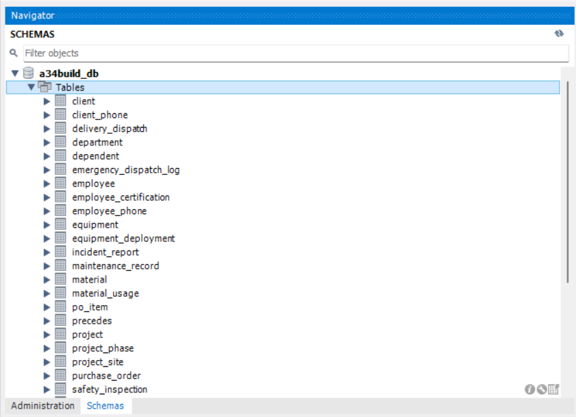

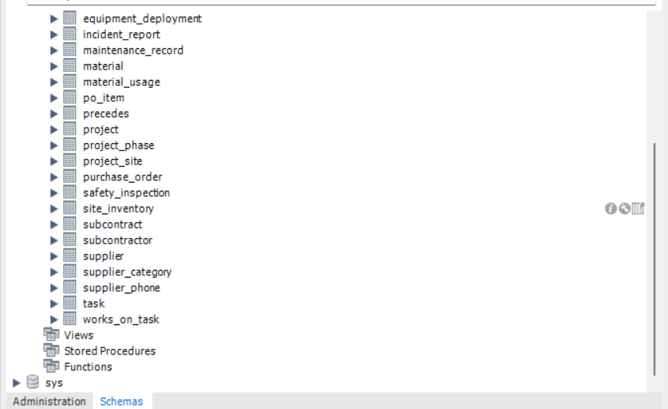

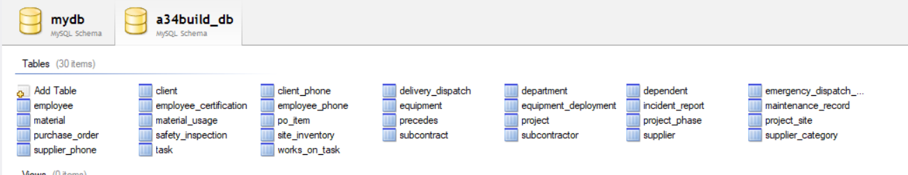

*Complete script included in **Appendix A.1** (`sql/01_schema_ddl.sql`).*

### 3.2.2 `02_triggers_procedures.sql` (14 Triggers Enforcing 7 Business Rules)

- Registers **14 triggers** enforcing all **7 complex business rules** identified in Phase 2 (including symmetrical `INSERT`/`UPDATE` guards where applicable):

  - **Rule 1 (`TRG_CHECK_PHASE_BUDGET_INSERT` / `_UPDATE`):** Total `PhaseBudget` across phases of a project cannot exceed `PROJECT.EstimatedBudget`.

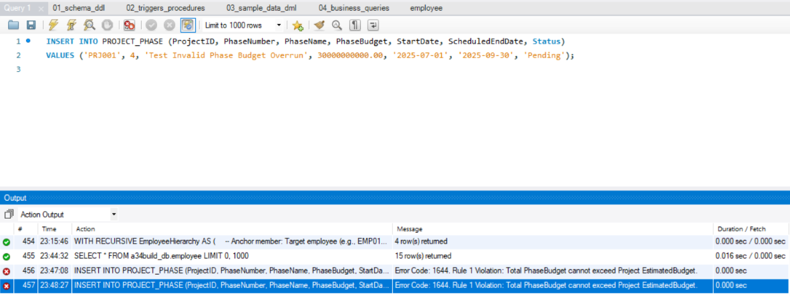

  - **Rule 2 (`TRG_CHECK_EQUIPMENT_OVERLAP_INSERT` / `_UPDATE`):** Prevents overlapping `EQUIPMENT_DEPLOYMENT` date intervals for the same machine.

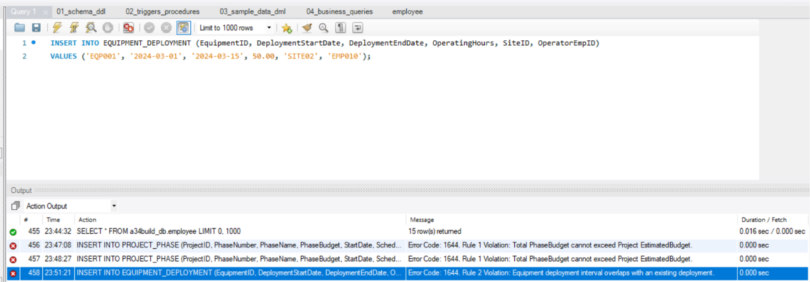

  - **Rule 3 (`TRG_CHECK_OPERATOR_CERT_INSERT` / `_UPDATE`):** Equipment operator must hold a valid certification matching the equipment category.

[TODO: Capture Rule 3 verification screenshot by running the Rule 3 tests in sql/06_rule_verification_tests.sql]

  - **Rule 4 (`TRG_CHECK_DAILY_HOURS_INSERT` / `_UPDATE`):** Worker logged hours (`HoursLogged`) cannot exceed `12.00` hours per calendar day.

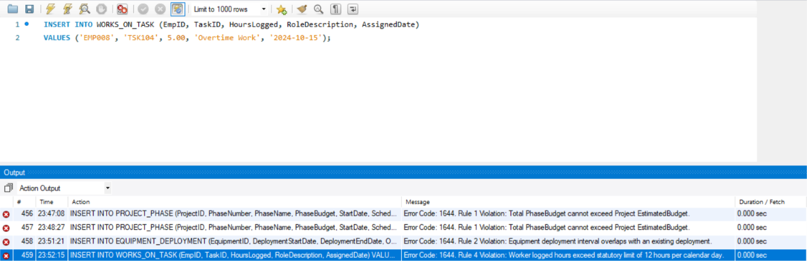

  - **Rule 5 (`TRG_CHECK_PRECEDES_DAG`):** `PRECEDES` task dependencies must form a DAG (no self-loops or cycles, checked via `WITH RECURSIVE`).

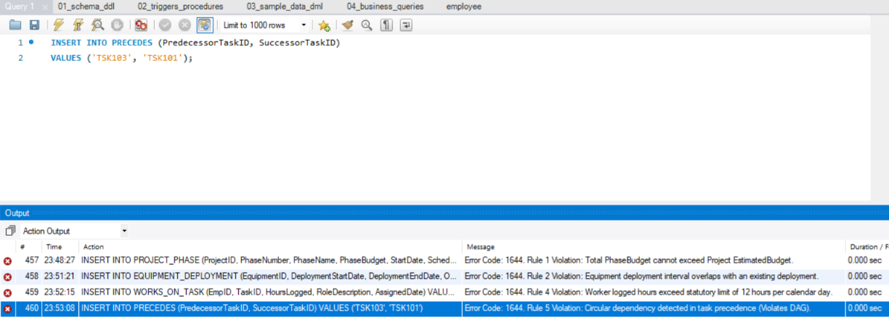

  - **Rule 6 (`TRG_CHECK_MATERIAL_STOCK_INSERT`, `TRG_DEDUCT_MATERIAL_STOCK_AFTER_INSERT`, `TRG_ADD_STOCK_ON_DELIVERY`):** Prevents `MATERIAL_USAGE` from exceeding `SITE_INVENTORY.CurrentStockQuantity`, automatically deducts consumed stock, and automatically replenishes site inventory via `TRG_ADD_STOCK_ON_DELIVERY` when a `DELIVERY_DISPATCH` row arrives with `Status = 'Received'`.

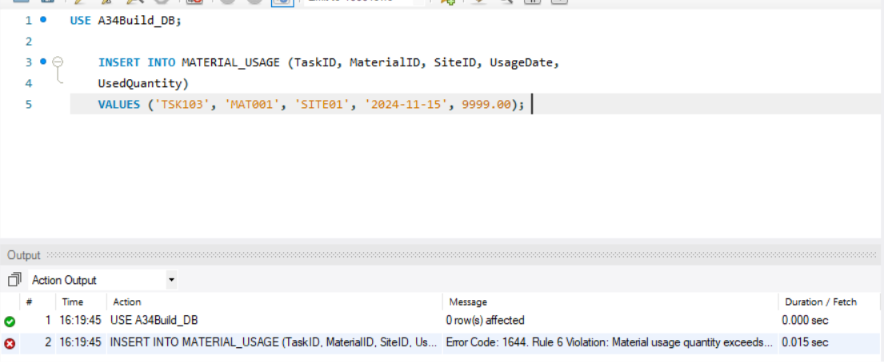

  - **Rule 7 (`TRG_CHECK_DIRECTOR_ACTIVE_PROJECT_INSERT` / `_UPDATE`):** An employee can direct at most one project with `Status = 'Active'`.

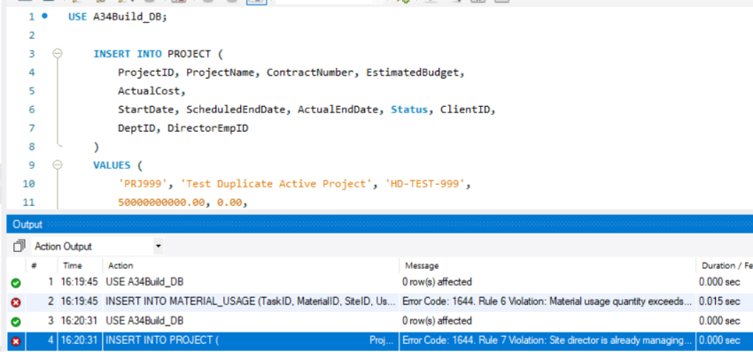

- **Representative Trigger Code (Rules 5 & 6):**

```sql
-- Rule 5: Acyclic task precedence DAG on PRECEDES
DROP TRIGGER IF EXISTS TRG_CHECK_PRECEDES_DAG //
CREATE TRIGGER TRG_CHECK_PRECEDES_DAG
BEFORE INSERT ON PRECEDES
FOR EACH ROW
BEGIN
    DECLARE v_cycle_detected INT DEFAULT 0;

    -- Self-loop check (enforced here; MySQL Error 3823 forbids table CHECK on FK column)
    IF NEW.PredecessorTaskID = NEW.SuccessorTaskID THEN
        SIGNAL SQLSTATE '45000'
        SET MESSAGE_TEXT = 'Rule 5 Violation: Self-loop precedence is strictly prohibited.';
    END IF;

    -- Detect path from SuccessorTaskID to PredecessorTaskID via recursive CTE
    WITH RECURSIVE PrecedenceChain AS (
        SELECT SuccessorTaskID AS CurrentTask
        FROM PRECEDES
        WHERE PredecessorTaskID = NEW.SuccessorTaskID
        
        UNION ALL
        
        SELECT p.SuccessorTaskID
        FROM PRECEDES p
        INNER JOIN PrecedenceChain pc ON p.PredecessorTaskID = pc.CurrentTask
    )
    SELECT COUNT(*) INTO v_cycle_detected
    FROM PrecedenceChain
    WHERE CurrentTask = NEW.PredecessorTaskID;

    IF v_cycle_detected > 0 THEN
        SIGNAL SQLSTATE '45000'
        SET MESSAGE_TEXT = 'Rule 5 Violation: Circular dependency detected in task precedence (Violates DAG).';
    END IF;
END //

-- Auto-replenish stock when delivery dispatch arrives
DROP TRIGGER IF EXISTS TRG_ADD_STOCK_ON_DELIVERY //
CREATE TRIGGER TRG_ADD_STOCK_ON_DELIVERY
AFTER INSERT ON DELIVERY_DISPATCH
FOR EACH ROW
BEGIN
    IF NEW.Status = 'Received' THEN
        -- Insert or Update inventory record
        INSERT INTO SITE_INVENTORY (SiteID, MaterialID, CurrentStockQuantity, MinStock, ReorderQuantity)
        VALUES (NEW.SiteID, NEW.MaterialID, NEW.DeliveredQuantity, 50.00, 200.00)
        ON DUPLICATE KEY UPDATE CurrentStockQuantity = CurrentStockQuantity + NEW.DeliveredQuantity;
    END IF;
END //
```

*Complete script included in **Appendix A.2** (`sql/02_triggers_procedures.sql`).*

### 3.2.3 `03_sample_data_dml.sql` (Realistic Sample Data & Physical EER)

- Populates all 29 core tables with realistic Vietnamese construction enterprise data (projects in Hanoi, Da Nang, and Ho Chi Minh City; employees, equipment fleet, POs, site inventory, subcontractors, safety inspections, and incident reports).

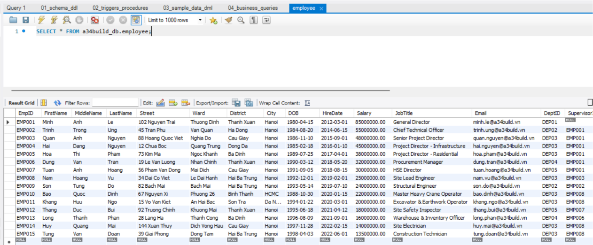

- **Reverse-Engineered Physical EER Diagram (`A34Build_DB`):**

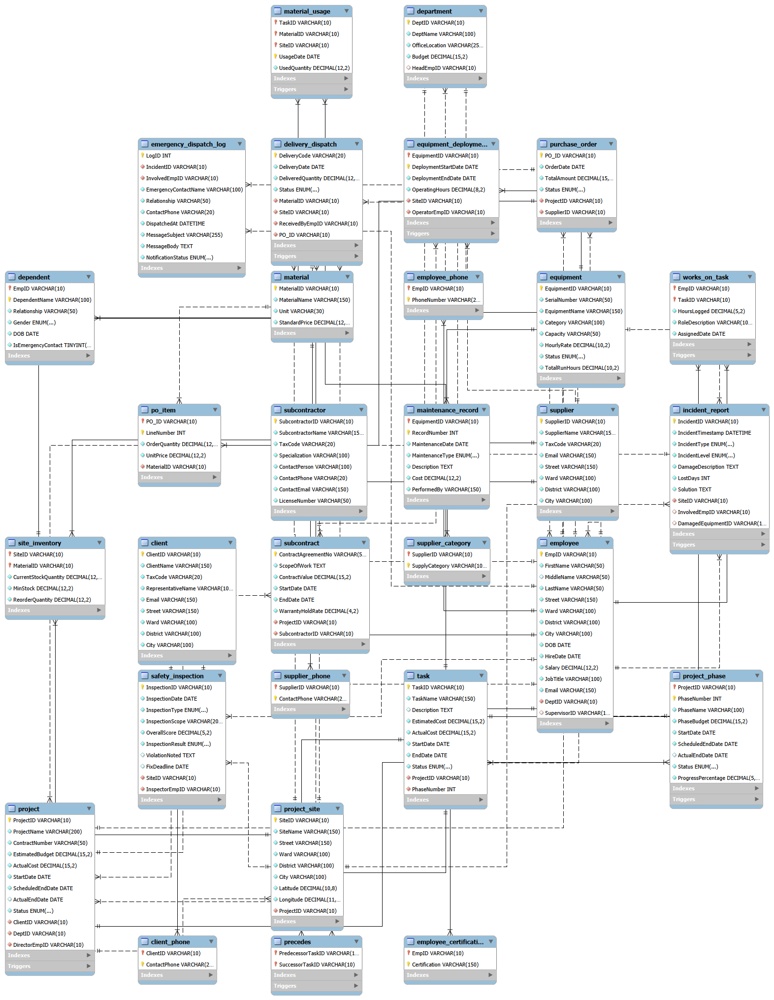

*Complete script included in **Appendix A.3** (`sql/03_sample_data_dml.sql`).*

### 3.2.4 `04_business_queries.sql` (Operational & Analytical Queries)

Implements 8 queries and reports covering operational checks, recursive hierarchy, cost/budget variance, Earned Value Management (EVM), safety & incident audit, and fleet utilization.

#### Query 1.1: Heavy Equipment Availability Checker

*Find machinery by category that is currently `'Available'` or not deployed in the next 14 days.*

```sql
SELECT 
    e.EquipmentID,
    e.EquipmentName,
    e.Category,
    e.Capacity,
    e.HourlyRate,
    e.Status AS CurrentStatus,
    COALESCE(MAX(ed.DeploymentEndDate), 'Never Deployed') AS LastDeploymentEndDate
FROM EQUIPMENT e
LEFT JOIN EQUIPMENT_DEPLOYMENT ed ON e.EquipmentID = ed.EquipmentID
WHERE e.Status NOT IN ('Decommissioned', 'Under-Maintenance')
  AND e.EquipmentID NOT IN (
      SELECT EquipmentID
      FROM EQUIPMENT_DEPLOYMENT
      WHERE DeploymentEndDate >= CURDATE()
        AND DeploymentStartDate <= DATE_ADD(CURDATE(), INTERVAL 14 DAY)
  )
GROUP BY e.EquipmentID, e.EquipmentName, e.Category, e.Capacity, e.HourlyRate, e.Status
ORDER BY e.HourlyRate DESC;
```

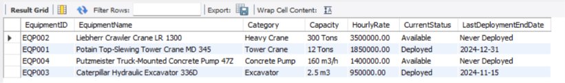

#### Query 1.2: Site Inventory Safety Stock Deficit Alert

*Check materials whose current stock on site is below or near the minimum safety stock.*

```sql
SELECT 
    ps.SiteID,
    ps.SiteName,
    p.ProjectName,
    m.MaterialID,
    m.MaterialName,
    m.Unit,
    si.CurrentStockQuantity,
    si.MinStock,
    si.ReorderQuantity,
    (si.MinStock - si.CurrentStockQuantity) AS DeficitQuantity,
    ROUND((si.CurrentStockQuantity / NULLIF(si.MinStock, 0)) * 100, 2) AS StockSufficiencyRatioPct,
    CASE 
        WHEN si.CurrentStockQuantity <= (si.MinStock * 0.5) THEN 'CRITICAL: Stockout Imminent'
        WHEN si.CurrentStockQuantity <= si.MinStock THEN 'WARNING: Below Min Safety Stock'
        ELSE 'NORMAL: Adequate'
    END AS ReplenishmentStatus
FROM SITE_INVENTORY si
JOIN PROJECT_SITE ps ON si.SiteID = ps.SiteID
JOIN PROJECT p ON ps.ProjectID = p.ProjectID
JOIN MATERIAL m ON si.MaterialID = m.MaterialID
WHERE si.CurrentStockQuantity <= (si.MinStock * 1.5)
ORDER BY StockSufficiencyRatioPct ASC;
```

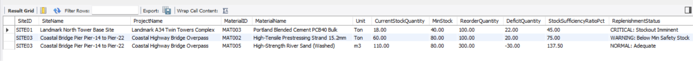

#### Query 1.3: Recursive Reporting Hierarchy (CTEs)

*Look up the complete management reporting chain of an employee up to the General Director.*

```sql
WITH RECURSIVE EmployeeHierarchy AS (
    -- Anchor member: Target employee (e.g., EMP010 - Crane Operator)
    SELECT 
        EmpID,
        FirstName,
        LastName,
        JobTitle,
        SupervisorID,
        1 AS HierarchyLevel,
        CAST(CONCAT(FirstName, ' ', LastName) AS CHAR(500)) AS ManagementPath
    FROM EMPLOYEE
    WHERE EmpID = 'EMP010'

    UNION ALL

    -- Recursive member: Traverse up to the supervisor
    SELECT 
        m.EmpID,
        m.FirstName,
        m.LastName,
        m.JobTitle,
        m.SupervisorID,
        eh.HierarchyLevel + 1,
        CONCAT(eh.ManagementPath, ' -> ', m.FirstName, ' ', m.LastName)
    FROM EMPLOYEE m
    INNER JOIN EmployeeHierarchy eh ON eh.SupervisorID = m.EmpID
)
SELECT 
    HierarchyLevel,
    EmpID,
    CONCAT(FirstName, ' ', LastName) AS EmployeeName,
    JobTitle,
    SupervisorID,
    ManagementPath
FROM EmployeeHierarchy
ORDER BY HierarchyLevel ASC;
```

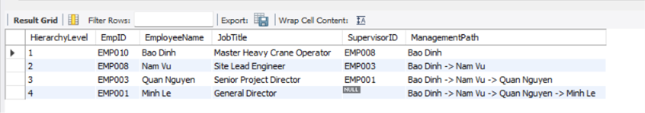

#### Query 1.4: Active Subcontractors & Retained Warranty Balances

*Calculate financial commitments and warranty retention hold amounts per subcontractor.*

```sql
SELECT 
    s.SubcontractorID,
    s.SubcontractorName,
    s.Specialization,
    sc.ContractAgreementNo,
    p.ProjectName,
    sc.ContractValue,
    sc.WarrantyHoldRate,
    ROUND((sc.ContractValue * sc.WarrantyHoldRate / 100.0), 2) AS WarrantyRetainedAmount,
    ROUND(sc.ContractValue - (sc.ContractValue * sc.WarrantyHoldRate / 100.0), 2) AS NetPayableAmount,
    sc.StartDate,
    sc.EndDate,
    DATEDIFF(sc.EndDate, CURDATE()) AS DaysRemaining
FROM SUBCONTRACT sc
JOIN SUBCONTRACTOR s ON sc.SubcontractorID = s.SubcontractorID
JOIN PROJECT p ON sc.ProjectID = p.ProjectID
WHERE sc.EndDate >= CURDATE()
ORDER BY sc.ContractValue DESC;
```

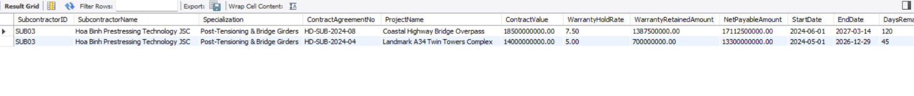

#### Report 2.1: Multi-Dimensional Project Cost vs. Budget Variance Report

*Aggregates budget breakdown and compares estimated budget with committed/actual costs (Labor, Machinery, Materials, Subcontracts).*

```sql
WITH LaborCost AS (
    SELECT 
        t.ProjectID,
        COALESCE(SUM(w.HoursLogged * (e.Salary / 160.0)), 0) AS TotalLaborCost
    FROM TASK t
    JOIN WORKS_ON_TASK w ON t.TaskID = w.TaskID
    JOIN EMPLOYEE e ON w.EmpID = e.EmpID
    GROUP BY t.ProjectID
),
EquipmentCost AS (
    SELECT 
        ps.ProjectID,
        COALESCE(SUM(ed.OperatingHours * eq.HourlyRate), 0) AS TotalEquipmentCost
    FROM PROJECT_SITE ps
    JOIN EQUIPMENT_DEPLOYMENT ed ON ps.SiteID = ed.SiteID
    JOIN EQUIPMENT eq ON ed.EquipmentID = eq.EquipmentID
    GROUP BY ps.ProjectID
),
MaterialCost AS (
    SELECT 
        t.ProjectID,
        COALESCE(SUM(mu.UsedQuantity * m.StandardPrice), 0) AS TotalMaterialCost
    FROM TASK t
    JOIN MATERIAL_USAGE mu ON t.TaskID = mu.TaskID
    JOIN MATERIAL m ON mu.MaterialID = m.MaterialID
    GROUP BY t.ProjectID
),
SubcontractCost AS (
    SELECT 
        ProjectID,
        COALESCE(SUM(ContractValue), 0) AS TotalSubcontractCost
    FROM SUBCONTRACT
    GROUP BY ProjectID
)
SELECT 
    p.ProjectID,
    p.ProjectName,
    p.Status,
    p.EstimatedBudget,
    p.ActualCost AS GeneralLedgerActualCost,
    ROUND(COALESCE(lc.TotalLaborCost, 0), 2) AS CalculatedLaborCost,
    ROUND(COALESCE(ec.TotalEquipmentCost, 0), 2) AS CalculatedEquipmentCost,
    ROUND(COALESCE(mc.TotalMaterialCost, 0), 2) AS CalculatedMaterialCost,
    ROUND(COALESCE(sc.TotalSubcontractCost, 0), 2) AS CommittedSubcontractCost,
    ROUND(
        COALESCE(lc.TotalLaborCost, 0) + 
        COALESCE(ec.TotalEquipmentCost, 0) + 
        COALESCE(mc.TotalMaterialCost, 0) + 
        COALESCE(sc.TotalSubcontractCost, 0), 2
    ) AS TotalProjectCommittedCost,
    ROUND(
        p.EstimatedBudget - (
            COALESCE(lc.TotalLaborCost, 0) + 
            COALESCE(ec.TotalEquipmentCost, 0) + 
            COALESCE(mc.TotalMaterialCost, 0) + 
            COALESCE(sc.TotalSubcontractCost, 0)
        ), 2
    ) AS RemainingBudgetVariance,
    ROUND(
        ((COALESCE(lc.TotalLaborCost, 0) + COALESCE(ec.TotalEquipmentCost, 0) + 
          COALESCE(mc.TotalMaterialCost, 0) + COALESCE(sc.TotalSubcontractCost, 0)) / NULLIF(p.EstimatedBudget, 0)) * 100, 2
    ) AS BudgetBurnRatePct
FROM PROJECT p
LEFT JOIN LaborCost lc ON p.ProjectID = lc.ProjectID
LEFT JOIN EquipmentCost ec ON p.ProjectID = ec.ProjectID
LEFT JOIN MaterialCost mc ON p.ProjectID = mc.ProjectID
LEFT JOIN SubcontractCost sc ON p.ProjectID = sc.ProjectID
ORDER BY p.EstimatedBudget DESC;
```

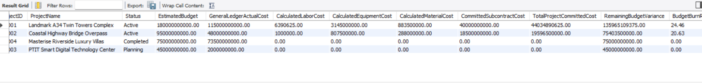

#### Report 2.2: Earned Value Analysis (EVM) Project Health Performance Report

*Computes Planned Value (PV), Earned Value (EV), Actual Cost (AC), CPI, and SPI.*

```sql
SELECT 
    p.ProjectID,
    p.ProjectName,
    SUM(pp.PhaseBudget) AS PlannedValue_PV,
    ROUND(SUM(pp.PhaseBudget * (pp.ProgressPercentage / 100.0)), 2) AS EarnedValue_EV,
    p.ActualCost AS ActualCost_AC,
    -- Cost Variance (CV = EV - AC)
    ROUND(SUM(pp.PhaseBudget * (pp.ProgressPercentage / 100.0)) - p.ActualCost, 2) AS CostVariance_CV,
    -- Schedule Variance (SV = EV - PV)
    ROUND(SUM(pp.PhaseBudget * (pp.ProgressPercentage / 100.0)) - SUM(pp.PhaseBudget), 2) AS ScheduleVariance_SV,
    -- Cost Performance Index (CPI = EV / AC)
    ROUND(SUM(pp.PhaseBudget * (pp.ProgressPercentage / 100.0)) / NULLIF(p.ActualCost, 0), 3) AS CostPerformanceIndex_CPI,
    -- Schedule Performance Index (SPI = EV / PV)
    ROUND(SUM(pp.PhaseBudget * (pp.ProgressPercentage / 100.0)) / NULLIF(SUM(pp.PhaseBudget), 0), 3) AS SchedulePerformanceIndex_SPI,
    -- Project Health Status
    CASE 
        WHEN (SUM(pp.PhaseBudget * (pp.ProgressPercentage / 100.0)) / NULLIF(p.ActualCost, 0)) >= 1.0
         AND (SUM(pp.PhaseBudget * (pp.ProgressPercentage / 100.0)) / NULLIF(SUM(pp.PhaseBudget), 0)) >= 1.0 
        THEN 'EXCELLENT: Ahead of Schedule & Under Budget'
        WHEN (SUM(pp.PhaseBudget * (pp.ProgressPercentage / 100.0)) / NULLIF(p.ActualCost, 0)) >= 0.90 
        THEN 'FAIR: Minor Variance Within Tolerance'
        ELSE 'ALERT: Cost Overrun or Significant Delay'
    END AS ProjectHealthStatus
FROM PROJECT p
JOIN PROJECT_PHASE pp ON p.ProjectID = pp.ProjectID
WHERE p.Status = 'Active'
GROUP BY p.ProjectID, p.ProjectName, p.ActualCost;
```

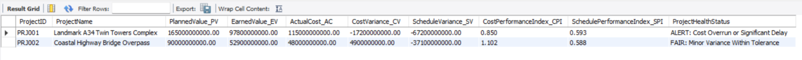

#### Report 2.3: Comprehensive Site Safety & Incident Audit Report

*Summarizes safety audit scores, open corrective actions, and lost-time injuries.*

```sql
SELECT 
    ps.SiteID,
    ps.SiteName,
    p.ProjectName,
    COUNT(DISTINCT si.InspectionID) AS TotalInspectionsConducted,
    ROUND(AVG(si.OverallScore), 2) AS AverageSafetyAuditScore,
    COUNT(DISTINCT CASE WHEN si.InspectionResult = 'Pass' THEN si.InspectionID END) AS PassedAudits,
    COUNT(DISTINCT CASE WHEN si.InspectionResult IN ('Conditional-Pass', 'Fail') THEN si.InspectionID END) AS AuditsWithDeficiencies,
    COUNT(DISTINCT ir.IncidentID) AS TotalIncidentsRecorded,
    COALESCE(SUM(ir.LostDays), 0) AS TotalLostDaysFromInjuries,
    CASE 
        WHEN COALESCE(SUM(ir.LostDays), 0) = 0 AND AVG(si.OverallScore) >= 90.0 THEN 'EXEMPLARY: Gold Standard Site'
        WHEN AVG(si.OverallScore) >= 75.0 THEN 'ACCEPTABLE: Standard Site Monitoring'
        ELSE 'HIGH RISK: Immediate Safety Intervention Required'
    END AS SiteRiskProfile
FROM PROJECT_SITE ps
JOIN PROJECT p ON ps.ProjectID = p.ProjectID
LEFT JOIN SAFETY_INSPECTION si ON ps.SiteID = si.SiteID
LEFT JOIN INCIDENT_REPORT ir ON ps.SiteID = ir.SiteID
GROUP BY ps.SiteID, ps.SiteName, p.ProjectName;
```

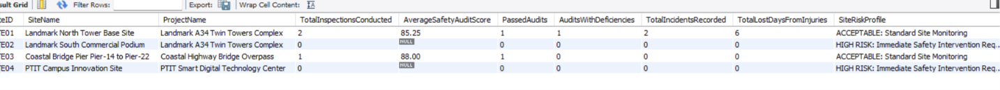

#### Report 2.4: Heavy Machinery Fleet Utilization & Maintenance Cost Ratio

*Evaluates machine productivity (run hours vs. maintenance expense).*

```sql
SELECT 
    e.EquipmentID,
    e.EquipmentName,
    e.Category,
    e.HourlyRate,
    e.TotalRunHours,
    ROUND(e.TotalRunHours * e.HourlyRate, 2) AS LifetimeGrossRevenueGenerated,
    COUNT(mr.RecordNumber) AS TotalMaintenanceSessions,
    COALESCE(SUM(mr.Cost), 0.00) AS TotalMaintenanceCostSpent,
    ROUND(
        (COALESCE(SUM(mr.Cost), 0.00) / NULLIF(e.TotalRunHours * e.HourlyRate, 0)) * 100, 2
    ) AS MaintenanceCostToRevenueRatioPct
FROM EQUIPMENT e
LEFT JOIN MAINTENANCE_RECORD mr ON e.EquipmentID = mr.EquipmentID
GROUP BY e.EquipmentID, e.EquipmentName, e.Category, e.HourlyRate, e.TotalRunHours
ORDER BY LifetimeGrossRevenueGenerated DESC;
```

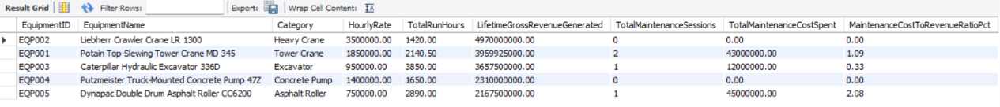

### 3.2.5 `05_user_queries.sql` (User Queries: Multi-Table Joins, Grouping & Filtering)

Implements 2 user-defined analytical queries demonstrating multi-table `INNER JOIN`, `WHERE` filtering, `GROUP BY`, `HAVING`, and `ORDER BY`, together with their corresponding Relational Algebra expressions and MySQL Workbench execution results.

#### Query 5.1: High-Salary Employee Workload by Department

*Retrieves employees earning at least 15,000,000 VND who are assigned to project tasks, summarizing their assigned task count and total logged hours.*

- **Problem Statement:** List employees with `Salary >= 15,000,000` VND who are assigned to tasks, displaying their department, salary, total assigned tasks, and total logged hours. Keep only employees with total logged hours greater than 0, sorted by total logged hours descending.

- **Relational Algebra Expression:**

  1. *Filter high-salary employees (`WHERE`):*

     $$
     E_{\text{high}} \leftarrow \sigma_{\text{Salary} \geq 15000000}(\text{EMPLOYEE})
     $$

  2. *Join with department and task assignment tables (`INNER JOIN`):*

     $$
     J_{1} \leftarrow (E_{\text{high}} \bowtie_{\text{DeptID}} \text{DEPARTMENT}) \bowtie_{\text{EmpID}} \text{WORKS\_ON\_TASK}
     $$

  3. *Group by employee and aggregate task count & logged hours (`GROUP BY`):*

     $$
     G_{1} \leftarrow {}_{\substack{\text{EmpID, FirstName, LastName,} \\ \text{DeptName, Salary}}}\mathcal{F}_{\substack{\text{COUNT(TaskID)} \rightarrow \text{TotalTasks}, \\ \text{SUM(HoursLogged)} \rightarrow \text{TotalHoursLogged}}}(J_{1})
     $$

  4. *Keep only employees with positive logged hours (`HAVING`):*

     $$
     H_{1} \leftarrow \sigma_{\text{TotalHoursLogged} > 0}(G_{1})
     $$

  5. *Project output columns and sort descending (`SELECT`, `ORDER BY`):*

     $$
     \text{Result}_{5.1} \leftarrow \tau_{\text{TotalHoursLogged} \downarrow}\Bigl(\pi_{\substack{\text{EmpID, FullName, DeptName,} \\ \text{Salary, TotalTasks, TotalHoursLogged}}}(H_{1})\Bigr)
     $$

- **SQL Code:**

```sql
SELECT 
    e.EmpID,
    CONCAT(e.FirstName, ' ', e.LastName) AS FullName,
    d.DeptName,
    e.Salary,
    COUNT(w.TaskID) AS TotalTasks,
    SUM(w.HoursLogged) AS TotalHoursLogged
FROM EMPLOYEE e
INNER JOIN DEPARTMENT d ON e.DeptID = d.DeptID
INNER JOIN WORKS_ON_TASK w ON e.EmpID = w.EmpID
WHERE e.Salary >= 15000000
GROUP BY e.EmpID, e.FirstName, e.LastName, d.DeptName, e.Salary
HAVING TotalHoursLogged > 0
ORDER BY TotalHoursLogged DESC;
```

- **Execution Result:**

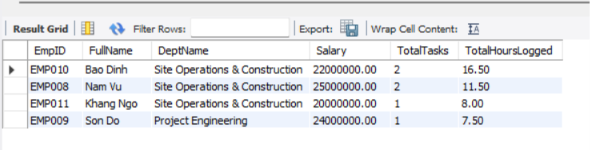

#### Query 5.2: Project & Job Site Count by Client

*Aggregates non-cancelled high-budget projects by client and counts their active job sites.*

- **Problem Statement:** Retrieve all non-cancelled projects with `EstimatedBudget > 30,000,000,000` VND, together with the client name and total number of job sites. Keep only projects that have at least 1 job site, sorted by `EstimatedBudget` descending.

- **Relational Algebra Expression:**

  1. *Filter non-cancelled projects with budget over 30 billion (`WHERE`):*

     $$
     P_{\text{high}} \leftarrow \sigma_{\text{Status} \neq \text{'Cancelled'} \land \text{EstimatedBudget} > 30000000000}(\text{PROJECT})
     $$

  2. *Join with client and project site tables (`INNER JOIN`):*

     $$
     J_{2} \leftarrow (P_{\text{high}} \bowtie_{\text{ClientID}} \text{CLIENT}) \bowtie_{\text{ProjectID}} \text{PROJECT\_SITE}
     $$

  3. *Group by project and count job sites (`GROUP BY`):*

     $$
     G_{2} \leftarrow {}_{\substack{\text{ProjectID, ProjectName, Status,} \\ \text{ClientName, EstimatedBudget}}}\mathcal{F}_{\text{COUNT(SiteID)} \rightarrow \text{TotalSites}}(J_{2})
     $$

  4. *Keep only projects with at least 1 site (`HAVING`):*

     $$
     H_{2} \leftarrow \sigma_{\text{TotalSites} \geq 1}(G_{2})
     $$

  5. *Project output columns and sort by budget descending (`SELECT`, `ORDER BY`):*

     $$
     \text{Result}_{5.2} \leftarrow \tau_{\text{EstimatedBudget} \downarrow}\Bigl(\pi_{\substack{\text{ProjectID, ProjectName, Status,} \\ \text{ClientName, EstimatedBudget, TotalSites}}}(H_{2})\Bigr)
     $$

- **SQL Code:**

```sql
SELECT 
    p.ProjectID,
    p.ProjectName,
    p.Status,
    c.ClientName,
    p.EstimatedBudget,
    COUNT(ps.SiteID) AS TotalSites
FROM PROJECT p
INNER JOIN CLIENT c ON p.ClientID = c.ClientID
INNER JOIN PROJECT_SITE ps ON p.ProjectID = ps.ProjectID
WHERE p.Status <> 'Cancelled'
  AND p.EstimatedBudget > 30000000000
GROUP BY p.ProjectID, p.ProjectName, p.Status, c.ClientName, p.EstimatedBudget
HAVING TotalSites >= 1
ORDER BY p.EstimatedBudget DESC;
```

- **Execution Result:**

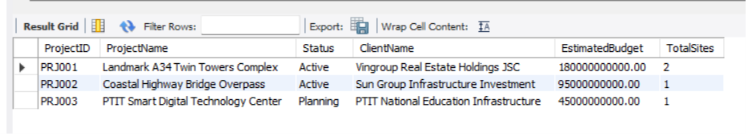

### 3.2.6 `06_rule_verification_tests.sql` (Automated Rule Verification Suite)

Provides repeatable pre-checks, negative boundary tests (`INSERT` and `UPDATE` trigger rejections via `SIGNAL SQLSTATE '45000'`), positive insertion tests, and cleanup statements across all 7 business rules.

*Complete script included in **Appendix A.4** (`sql/06_rule_verification_tests.sql`).*

# 4. Conclusion

In Phase 3, we normalized and verified all 29 relations of the A34Build enterprise schema against 1NF, 2NF, and 3NF, eliminating the partial key dependency in `EQUIPMENT_DEPLOYMENT` and the transitive dependency in `DELIVERY_DISPATCH`, and implemented the physical schema in MySQL 8.0.46. All 29 normalized tables, 14 triggers enforcing the 7 complex business rules, sample dataset (`03_sample_data_dml.sql`), operational/EVM analytical queries (`04_business_queries.sql` and `05_user_queries.sql`), and automated trigger verification tests (`06_rule_verification_tests.sql`) are synchronized and ready for Phase 4 demonstration.

# Appendix A: Complete SQL Scripts

The source scripts for database creation, triggers, sample seed data, and rule verification are reproduced verbatim below (`04_business_queries.sql` and `05_user_queries.sql` are already included in full in Sections 3.2.4 and 3.2.5).

## A.1 `sql/01_schema_ddl.sql`

```sql
-- A34Build DB (MySQL 8.0+ / InnoDB / utf8mb4) - E24-Class 5, Group 5
-- File 01: Schema DDL (29 Core Tables & Performance Indexes, 3NF)

DROP DATABASE IF EXISTS A34Build_DB;
CREATE DATABASE A34Build_DB
  CHARACTER SET utf8mb4
  COLLATE utf8mb4_unicode_ci;

USE A34Build_DB;

-- Subsystem 1: Organization & Human Resources (HR)

-- 1. Table: DEPARTMENT
-- Note: HeadEmpID FK is added via ALTER TABLE later due to circular dependency with EMPLOYEE.
CREATE TABLE DEPARTMENT (
    DeptID VARCHAR(10) NOT NULL,
    DeptName VARCHAR(100) NOT NULL,
    OfficeLocation VARCHAR(255) NOT NULL,
    Budget DECIMAL(15,2) NOT NULL DEFAULT 0.00,
    HeadEmpID VARCHAR(10) NULL,
    CONSTRAINT PK_DEPARTMENT PRIMARY KEY (DeptID),
    CONSTRAINT UQ_DEPARTMENT_DeptName UNIQUE (DeptName),
    CONSTRAINT UQ_DEPARTMENT_HeadEmpID UNIQUE (HeadEmpID),
    CONSTRAINT CK_DEPARTMENT_Budget CHECK (Budget >= 0)
) ENGINE=InnoDB DEFAULT CHARSET=utf8mb4 COLLATE=utf8mb4_unicode_ci;

-- 2. Table: EMPLOYEE
CREATE TABLE EMPLOYEE (
    EmpID VARCHAR(10) NOT NULL,
    FirstName VARCHAR(50) NOT NULL,
    MiddleName VARCHAR(50) NULL,
    LastName VARCHAR(50) NOT NULL,
    Street VARCHAR(150) NOT NULL,
    Ward VARCHAR(100) NOT NULL,
    District VARCHAR(100) NOT NULL,
    City VARCHAR(100) NOT NULL,
    DOB DATE NOT NULL,
    HireDate DATE NOT NULL,
    Salary DECIMAL(12,2) NOT NULL,
    JobTitle VARCHAR(100) NOT NULL,
    Email VARCHAR(150) NOT NULL,
    DeptID VARCHAR(10) NOT NULL,
    SupervisorID VARCHAR(10) NULL,
    CONSTRAINT PK_EMPLOYEE PRIMARY KEY (EmpID),
    CONSTRAINT UQ_EMPLOYEE_Email UNIQUE (Email),
    CONSTRAINT CK_EMPLOYEE_Salary CHECK (Salary > 0),
    CONSTRAINT CK_EMPLOYEE_HireDate CHECK (HireDate >= DOB),
    CONSTRAINT FK_EMPLOYEE_DeptID FOREIGN KEY (DeptID) 
        REFERENCES DEPARTMENT (DeptID) 
        ON UPDATE CASCADE ON DELETE RESTRICT,
    CONSTRAINT FK_EMPLOYEE_SupervisorID FOREIGN KEY (SupervisorID) 
        REFERENCES EMPLOYEE (EmpID) 
        ON UPDATE CASCADE ON DELETE SET NULL
) ENGINE=InnoDB DEFAULT CHARSET=utf8mb4 COLLATE=utf8mb4_unicode_ci;

-- Resolve circular FK from DEPARTMENT to EMPLOYEE
ALTER TABLE DEPARTMENT
    ADD CONSTRAINT FK_DEPARTMENT_HeadEmpID FOREIGN KEY (HeadEmpID)
    REFERENCES EMPLOYEE (EmpID)
    ON UPDATE CASCADE ON DELETE SET NULL;

-- 3. Table: EMPLOYEE_PHONE (Multivalued Attribute)
CREATE TABLE EMPLOYEE_PHONE (
    EmpID VARCHAR(10) NOT NULL,
    PhoneNumber VARCHAR(20) NOT NULL,
    CONSTRAINT PK_EMPLOYEE_PHONE PRIMARY KEY (EmpID, PhoneNumber),
    CONSTRAINT FK_EMPLOYEE_PHONE_EmpID FOREIGN KEY (EmpID)
        REFERENCES EMPLOYEE (EmpID)
        ON UPDATE CASCADE ON DELETE CASCADE
) ENGINE=InnoDB DEFAULT CHARSET=utf8mb4 COLLATE=utf8mb4_unicode_ci;

-- 4. Table: EMPLOYEE_CERTIFICATION (Multivalued Attribute)
CREATE TABLE EMPLOYEE_CERTIFICATION (
    EmpID VARCHAR(10) NOT NULL,
    Certification VARCHAR(150) NOT NULL,
    CONSTRAINT PK_EMPLOYEE_CERTIFICATION PRIMARY KEY (EmpID, Certification),
    CONSTRAINT FK_EMPLOYEE_CERTIFICATION_EmpID FOREIGN KEY (EmpID)
        REFERENCES EMPLOYEE (EmpID)
        ON UPDATE CASCADE ON DELETE CASCADE
) ENGINE=InnoDB DEFAULT CHARSET=utf8mb4 COLLATE=utf8mb4_unicode_ci;

-- 5. Table: DEPENDENT (Weak Entity dependent on EMPLOYEE)
CREATE TABLE DEPENDENT (
    EmpID VARCHAR(10) NOT NULL,
    DependentName VARCHAR(100) NOT NULL,
    Relationship VARCHAR(50) NOT NULL,
    Gender ENUM('Male', 'Female', 'Other') NOT NULL,
    DOB DATE NOT NULL,
    IsEmergencyContact BOOLEAN NOT NULL DEFAULT FALSE,
    CONSTRAINT PK_DEPENDENT PRIMARY KEY (EmpID, DependentName),
    CONSTRAINT FK_DEPENDENT_EmpID FOREIGN KEY (EmpID)
        REFERENCES EMPLOYEE (EmpID)
        ON UPDATE CASCADE ON DELETE CASCADE
) ENGINE=InnoDB DEFAULT CHARSET=utf8mb4 COLLATE=utf8mb4_unicode_ci;

-- Subsystem 2: Client & Project Management

-- 6. Table: CLIENT
CREATE TABLE CLIENT (
    ClientID VARCHAR(10) NOT NULL,
    ClientName VARCHAR(150) NOT NULL,
    TaxCode VARCHAR(20) NOT NULL,
    RepresentativeName VARCHAR(100) NOT NULL,
    Email VARCHAR(150) NOT NULL,
    Street VARCHAR(150) NOT NULL,
    Ward VARCHAR(100) NOT NULL,
    District VARCHAR(100) NOT NULL,
    City VARCHAR(100) NOT NULL,
    CONSTRAINT PK_CLIENT PRIMARY KEY (ClientID),
    CONSTRAINT UQ_CLIENT_TaxCode UNIQUE (TaxCode),
    CONSTRAINT UQ_CLIENT_Email UNIQUE (Email)
) ENGINE=InnoDB DEFAULT CHARSET=utf8mb4 COLLATE=utf8mb4_unicode_ci;

-- 7. Table: CLIENT_PHONE (Multivalued Attribute)
CREATE TABLE CLIENT_PHONE (
    ClientID VARCHAR(10) NOT NULL,
    ContactPhone VARCHAR(20) NOT NULL,
    CONSTRAINT PK_CLIENT_PHONE PRIMARY KEY (ClientID, ContactPhone),
    CONSTRAINT FK_CLIENT_PHONE_ClientID FOREIGN KEY (ClientID)
        REFERENCES CLIENT (ClientID)
        ON UPDATE CASCADE ON DELETE CASCADE
) ENGINE=InnoDB DEFAULT CHARSET=utf8mb4 COLLATE=utf8mb4_unicode_ci;

-- 8. Table: PROJECT
CREATE TABLE PROJECT (
    ProjectID VARCHAR(10) NOT NULL,
    ProjectName VARCHAR(200) NOT NULL,
    ContractNumber VARCHAR(50) NOT NULL,
    EstimatedBudget DECIMAL(15,2) NOT NULL,
    ActualCost DECIMAL(15,2) NOT NULL DEFAULT 0.00,
    StartDate DATE NOT NULL,
    ScheduledEndDate DATE NOT NULL,
    ActualEndDate DATE NULL,
    Status ENUM('Planning', 'Active', 'Suspended', 'Completed', 'Cancelled') NOT NULL DEFAULT 'Planning',
    ClientID VARCHAR(10) NOT NULL,
    DeptID VARCHAR(10) NOT NULL,
    DirectorEmpID VARCHAR(10) NOT NULL,
    CONSTRAINT PK_PROJECT PRIMARY KEY (ProjectID),
    CONSTRAINT UQ_PROJECT_ProjectName UNIQUE (ProjectName),
    CONSTRAINT UQ_PROJECT_ContractNumber UNIQUE (ContractNumber),
    CONSTRAINT CK_PROJECT_Dates CHECK (ScheduledEndDate >= StartDate),
    CONSTRAINT CK_PROJECT_ActualDates CHECK (ActualEndDate IS NULL OR ActualEndDate >= StartDate),
    CONSTRAINT CK_PROJECT_Budget CHECK (EstimatedBudget >= 0 AND ActualCost >= 0),
    CONSTRAINT FK_PROJECT_ClientID FOREIGN KEY (ClientID)
        REFERENCES CLIENT (ClientID)
        ON UPDATE CASCADE ON DELETE RESTRICT,
    CONSTRAINT FK_PROJECT_DeptID FOREIGN KEY (DeptID)
        REFERENCES DEPARTMENT (DeptID)
        ON UPDATE CASCADE ON DELETE RESTRICT,
    CONSTRAINT FK_PROJECT_DirectorEmpID FOREIGN KEY (DirectorEmpID)
        REFERENCES EMPLOYEE (EmpID)
        ON UPDATE CASCADE ON DELETE RESTRICT
) ENGINE=InnoDB DEFAULT CHARSET=utf8mb4 COLLATE=utf8mb4_unicode_ci;

-- 9. Table: PROJECT_SITE
CREATE TABLE PROJECT_SITE (
    SiteID VARCHAR(10) NOT NULL,
    SiteName VARCHAR(150) NOT NULL,
    Street VARCHAR(150) NOT NULL,
    Ward VARCHAR(100) NOT NULL,
    District VARCHAR(100) NOT NULL,
    City VARCHAR(100) NOT NULL,
    Latitude DECIMAL(10,8) NOT NULL,
    Longitude DECIMAL(11,8) NOT NULL,
    ProjectID VARCHAR(10) NOT NULL,
    CONSTRAINT PK_PROJECT_SITE PRIMARY KEY (SiteID),
    CONSTRAINT UQ_PROJECT_SITE_Project_SiteName UNIQUE (ProjectID, SiteName),
    CONSTRAINT UQ_PROJECT_SITE_Coordinates UNIQUE (Latitude, Longitude),
    CONSTRAINT CK_PROJECT_SITE_Lat CHECK (Latitude BETWEEN -90.0 AND 90.0),
    CONSTRAINT CK_PROJECT_SITE_Long CHECK (Longitude BETWEEN -180.0 AND 180.0),
    CONSTRAINT FK_PROJECT_SITE_ProjectID FOREIGN KEY (ProjectID)
        REFERENCES PROJECT (ProjectID)
        ON UPDATE CASCADE ON DELETE CASCADE
) ENGINE=InnoDB DEFAULT CHARSET=utf8mb4 COLLATE=utf8mb4_unicode_ci;

-- 10. Table: PROJECT_PHASE (Weak Entity dependent on PROJECT)
CREATE TABLE PROJECT_PHASE (
    ProjectID VARCHAR(10) NOT NULL,
    PhaseNumber INT NOT NULL,
    PhaseName VARCHAR(100) NOT NULL,
    PhaseBudget DECIMAL(15,2) NOT NULL DEFAULT 0.00,
    StartDate DATE NOT NULL,
    ScheduledEndDate DATE NOT NULL,
    ActualEndDate DATE NULL,
    Status ENUM('Pending', 'In-Progress', 'Completed', 'Delayed') NOT NULL DEFAULT 'Pending',
    ProgressPercentage DECIMAL(5,2) NOT NULL DEFAULT 0.00,
    CONSTRAINT PK_PROJECT_PHASE PRIMARY KEY (ProjectID, PhaseNumber),
    CONSTRAINT CK_PROJECT_PHASE_PhaseNumber CHECK (PhaseNumber > 0),
    CONSTRAINT CK_PROJECT_PHASE_Dates CHECK (ScheduledEndDate >= StartDate),
    CONSTRAINT CK_PROJECT_PHASE_ActualDates CHECK (ActualEndDate IS NULL OR ActualEndDate >= StartDate),
    CONSTRAINT CK_PROJECT_PHASE_Budget CHECK (PhaseBudget >= 0),
    CONSTRAINT CK_PROJECT_PHASE_Progress CHECK (ProgressPercentage BETWEEN 0.00 AND 100.00),
    CONSTRAINT FK_PROJECT_PHASE_ProjectID FOREIGN KEY (ProjectID)
        REFERENCES PROJECT (ProjectID)
        ON UPDATE CASCADE ON DELETE CASCADE
) ENGINE=InnoDB DEFAULT CHARSET=utf8mb4 COLLATE=utf8mb4_unicode_ci;

-- 11. Table: TASK
CREATE TABLE TASK (
    TaskID VARCHAR(10) NOT NULL,
    TaskName VARCHAR(150) NOT NULL,
    Description TEXT NULL,
    EstimatedCost DECIMAL(15,2) NOT NULL DEFAULT 0.00,
    ActualCost DECIMAL(15,2) NOT NULL DEFAULT 0.00,
    StartDate DATE NOT NULL,
    EndDate DATE NOT NULL,
    Status ENUM('Not-Started', 'In-Progress', 'Completed', 'Blocked') NOT NULL DEFAULT 'Not-Started',
    ProjectID VARCHAR(10) NOT NULL,
    PhaseNumber INT NOT NULL,
    CONSTRAINT PK_TASK PRIMARY KEY (TaskID),
    CONSTRAINT UQ_TASK_Phase_TaskName UNIQUE (ProjectID, PhaseNumber, TaskName),
    CONSTRAINT CK_TASK_Dates CHECK (EndDate >= StartDate),
    CONSTRAINT CK_TASK_Costs CHECK (EstimatedCost >= 0 AND ActualCost >= 0),
    CONSTRAINT FK_TASK_Phase FOREIGN KEY (ProjectID, PhaseNumber)
        REFERENCES PROJECT_PHASE (ProjectID, PhaseNumber)
        ON UPDATE CASCADE ON DELETE CASCADE
) ENGINE=InnoDB DEFAULT CHARSET=utf8mb4 COLLATE=utf8mb4_unicode_ci;

-- 12. Table: PRECEDES (Recursive M:N relationship on TASK)
CREATE TABLE PRECEDES (
    PredecessorTaskID VARCHAR(10) NOT NULL,
    SuccessorTaskID VARCHAR(10) NOT NULL,
    CONSTRAINT PK_PRECEDES PRIMARY KEY (PredecessorTaskID, SuccessorTaskID),
    -- Note: Self-loop (PredecessorTaskID <> SuccessorTaskID) is enforced via TRG_CHECK_PRECEDES_DAG
    -- because MySQL 8.0 forbids CHECK constraints on columns used in FK referential actions (Error 3823).
    CONSTRAINT FK_PRECEDES_Predecessor FOREIGN KEY (PredecessorTaskID)
        REFERENCES TASK (TaskID)
        ON UPDATE CASCADE ON DELETE RESTRICT,
    CONSTRAINT FK_PRECEDES_Successor FOREIGN KEY (SuccessorTaskID)
        REFERENCES TASK (TaskID)
        ON UPDATE CASCADE ON DELETE CASCADE
) ENGINE=InnoDB DEFAULT CHARSET=utf8mb4 COLLATE=utf8mb4_unicode_ci;

-- 13. Table: WORKS_ON_TASK (M:N Relationship between EMPLOYEE and TASK)
CREATE TABLE WORKS_ON_TASK (
    EmpID VARCHAR(10) NOT NULL,
    TaskID VARCHAR(10) NOT NULL,
    HoursLogged DECIMAL(5,2) NOT NULL DEFAULT 0.00,
    RoleDescription VARCHAR(100) NOT NULL,
    AssignedDate DATE NOT NULL,
    CONSTRAINT PK_WORKS_ON_TASK PRIMARY KEY (EmpID, TaskID),
    CONSTRAINT CK_WORKS_ON_TASK_Hours CHECK (HoursLogged >= 0.00 AND HoursLogged <= 24.00),
    CONSTRAINT FK_WORKS_ON_TASK_EmpID FOREIGN KEY (EmpID)
        REFERENCES EMPLOYEE (EmpID)
        ON UPDATE CASCADE ON DELETE RESTRICT,
    CONSTRAINT FK_WORKS_ON_TASK_TaskID FOREIGN KEY (TaskID)
        REFERENCES TASK (TaskID)
        ON UPDATE CASCADE ON DELETE CASCADE
) ENGINE=InnoDB DEFAULT CHARSET=utf8mb4 COLLATE=utf8mb4_unicode_ci;

-- Subsystem 3: Heavy Machinery & Equipment Management

-- 14. Table: EQUIPMENT
CREATE TABLE EQUIPMENT (
    EquipmentID VARCHAR(10) NOT NULL,
    SerialNumber VARCHAR(50) NOT NULL,
    EquipmentName VARCHAR(150) NOT NULL,
    Category VARCHAR(100) NOT NULL,
    Capacity VARCHAR(50) NOT NULL,
    HourlyRate DECIMAL(10,2) NOT NULL,
    Status ENUM('Available', 'Deployed', 'Under-Maintenance', 'Decommissioned') NOT NULL DEFAULT 'Available',
    TotalRunHours DECIMAL(10,2) NOT NULL DEFAULT 0.00,
    CONSTRAINT PK_EQUIPMENT PRIMARY KEY (EquipmentID),
    CONSTRAINT UQ_EQUIPMENT_SerialNumber UNIQUE (SerialNumber),
    CONSTRAINT CK_EQUIPMENT_HourlyRate CHECK (HourlyRate >= 0),
    CONSTRAINT CK_EQUIPMENT_TotalRunHours CHECK (TotalRunHours >= 0)
) ENGINE=InnoDB DEFAULT CHARSET=utf8mb4 COLLATE=utf8mb4_unicode_ci;

-- 15. Table: MAINTENANCE_RECORD (Weak Entity dependent on EQUIPMENT)
CREATE TABLE MAINTENANCE_RECORD (
    EquipmentID VARCHAR(10) NOT NULL,
    RecordNumber INT NOT NULL,
    MaintenanceDate DATE NOT NULL,
    MaintenanceType ENUM('Routine', 'Preventive', 'Corrective', 'Emergency') NOT NULL,
    Description TEXT NOT NULL,
    Cost DECIMAL(12,2) NOT NULL DEFAULT 0.00,
    PerformedBy VARCHAR(150) NOT NULL,
    CONSTRAINT PK_MAINTENANCE_RECORD PRIMARY KEY (EquipmentID, RecordNumber),
    CONSTRAINT CK_MAINTENANCE_RECORD_Num CHECK (RecordNumber > 0),
    CONSTRAINT CK_MAINTENANCE_RECORD_Cost CHECK (Cost >= 0),
    CONSTRAINT FK_MAINTENANCE_RECORD_EquipmentID FOREIGN KEY (EquipmentID)
        REFERENCES EQUIPMENT (EquipmentID)
        ON UPDATE CASCADE ON DELETE CASCADE
) ENGINE=InnoDB DEFAULT CHARSET=utf8mb4 COLLATE=utf8mb4_unicode_ci;

-- 16. Table: EQUIPMENT_DEPLOYMENT (3NF Refined: Minimal PK is EquipmentID, DeploymentStartDate)
CREATE TABLE EQUIPMENT_DEPLOYMENT (
    EquipmentID VARCHAR(10) NOT NULL,
    DeploymentStartDate DATE NOT NULL,
    DeploymentEndDate DATE NOT NULL,
    OperatingHours DECIMAL(8,2) NOT NULL DEFAULT 0.00,
    SiteID VARCHAR(10) NOT NULL,
    OperatorEmpID VARCHAR(10) NOT NULL,
    CONSTRAINT PK_EQUIPMENT_DEPLOYMENT PRIMARY KEY (EquipmentID, DeploymentStartDate),
    CONSTRAINT CK_EQUIPMENT_DEPLOYMENT_Dates CHECK (DeploymentEndDate >= DeploymentStartDate),
    CONSTRAINT CK_EQUIPMENT_DEPLOYMENT_Hours CHECK (OperatingHours >= 0),
    CONSTRAINT FK_EQUIPMENT_DEPLOYMENT_EquipmentID FOREIGN KEY (EquipmentID)
        REFERENCES EQUIPMENT (EquipmentID)
        ON UPDATE CASCADE ON DELETE RESTRICT,
    CONSTRAINT FK_EQUIPMENT_DEPLOYMENT_SiteID FOREIGN KEY (SiteID)
        REFERENCES PROJECT_SITE (SiteID)
        ON UPDATE CASCADE ON DELETE RESTRICT,
    CONSTRAINT FK_EQUIPMENT_DEPLOYMENT_OperatorEmpID FOREIGN KEY (OperatorEmpID)
        REFERENCES EMPLOYEE (EmpID)
        ON UPDATE CASCADE ON DELETE RESTRICT
) ENGINE=InnoDB DEFAULT CHARSET=utf8mb4 COLLATE=utf8mb4_unicode_ci;

-- Subsystem 4: Procurement, Inventory & Materials

-- 17. Table: SUPPLIER
CREATE TABLE SUPPLIER (
    SupplierID VARCHAR(10) NOT NULL,
    SupplierName VARCHAR(150) NOT NULL,
    TaxCode VARCHAR(20) NOT NULL,
    Email VARCHAR(150) NOT NULL,
    Street VARCHAR(150) NOT NULL,
    Ward VARCHAR(100) NOT NULL,
    District VARCHAR(100) NOT NULL,
    City VARCHAR(100) NOT NULL,
    CONSTRAINT PK_SUPPLIER PRIMARY KEY (SupplierID),
    CONSTRAINT UQ_SUPPLIER_TaxCode UNIQUE (TaxCode),
    CONSTRAINT UQ_SUPPLIER_Email UNIQUE (Email)
) ENGINE=InnoDB DEFAULT CHARSET=utf8mb4 COLLATE=utf8mb4_unicode_ci;

-- 18. Table: SUPPLIER_PHONE (Multivalued Attribute)
CREATE TABLE SUPPLIER_PHONE (
    SupplierID VARCHAR(10) NOT NULL,
    ContactPhone VARCHAR(20) NOT NULL,
    CONSTRAINT PK_SUPPLIER_PHONE PRIMARY KEY (SupplierID, ContactPhone),
    CONSTRAINT FK_SUPPLIER_PHONE_SupplierID FOREIGN KEY (SupplierID)
        REFERENCES SUPPLIER (SupplierID)
        ON UPDATE CASCADE ON DELETE CASCADE
) ENGINE=InnoDB DEFAULT CHARSET=utf8mb4 COLLATE=utf8mb4_unicode_ci;

-- 19. Table: SUPPLIER_CATEGORY (Multivalued Attribute)
CREATE TABLE SUPPLIER_CATEGORY (
    SupplierID VARCHAR(10) NOT NULL,
    SupplyCategory VARCHAR(100) NOT NULL,
    CONSTRAINT PK_SUPPLIER_CATEGORY PRIMARY KEY (SupplierID, SupplyCategory),
    CONSTRAINT FK_SUPPLIER_CATEGORY_SupplierID FOREIGN KEY (SupplierID)
        REFERENCES SUPPLIER (SupplierID)
        ON UPDATE CASCADE ON DELETE CASCADE
) ENGINE=InnoDB DEFAULT CHARSET=utf8mb4 COLLATE=utf8mb4_unicode_ci;

-- 20. Table: MATERIAL
CREATE TABLE MATERIAL (
    MaterialID VARCHAR(10) NOT NULL,
    MaterialName VARCHAR(150) NOT NULL,
    Unit VARCHAR(30) NOT NULL,
    StandardPrice DECIMAL(12,2) NOT NULL,
    CONSTRAINT PK_MATERIAL PRIMARY KEY (MaterialID),
    CONSTRAINT UQ_MATERIAL_MaterialName UNIQUE (MaterialName),
    CONSTRAINT CK_MATERIAL_StandardPrice CHECK (StandardPrice >= 0)
) ENGINE=InnoDB DEFAULT CHARSET=utf8mb4 COLLATE=utf8mb4_unicode_ci;

-- 21. Table: PURCHASE_ORDER
CREATE TABLE PURCHASE_ORDER (
    PO_ID VARCHAR(10) NOT NULL,
    OrderDate DATE NOT NULL,
    TotalAmount DECIMAL(15,2) NOT NULL DEFAULT 0.00,
    Status ENUM('Draft', 'Approved', 'Shipped', 'Received', 'Cancelled') NOT NULL DEFAULT 'Draft',
    ProjectID VARCHAR(10) NOT NULL,
    SupplierID VARCHAR(10) NOT NULL,
    CONSTRAINT PK_PURCHASE_ORDER PRIMARY KEY (PO_ID),
    CONSTRAINT CK_PURCHASE_ORDER_TotalAmount CHECK (TotalAmount >= 0),
    CONSTRAINT FK_PURCHASE_ORDER_ProjectID FOREIGN KEY (ProjectID)
        REFERENCES PROJECT (ProjectID)
        ON UPDATE CASCADE ON DELETE RESTRICT,
    CONSTRAINT FK_PURCHASE_ORDER_SupplierID FOREIGN KEY (SupplierID)
        REFERENCES SUPPLIER (SupplierID)
        ON UPDATE CASCADE ON DELETE RESTRICT
) ENGINE=InnoDB DEFAULT CHARSET=utf8mb4 COLLATE=utf8mb4_unicode_ci;

-- 22. Table: PO_ITEM (Weak Entity dependent on PURCHASE_ORDER)
CREATE TABLE PO_ITEM (
    PO_ID VARCHAR(10) NOT NULL,
    LineNumber INT NOT NULL,
    OrderQuantity DECIMAL(12,2) NOT NULL,
    UnitPrice DECIMAL(12,2) NOT NULL,
    MaterialID VARCHAR(10) NOT NULL,
    CONSTRAINT PK_PO_ITEM PRIMARY KEY (PO_ID, LineNumber),
    CONSTRAINT UQ_PO_ITEM_PO_Material UNIQUE (PO_ID, MaterialID),
    CONSTRAINT CK_PO_ITEM_LineNumber CHECK (LineNumber > 0),
    CONSTRAINT CK_PO_ITEM_Quantity CHECK (OrderQuantity > 0),
    CONSTRAINT CK_PO_ITEM_UnitPrice CHECK (UnitPrice >= 0),
    CONSTRAINT FK_PO_ITEM_PO_ID FOREIGN KEY (PO_ID)
        REFERENCES PURCHASE_ORDER (PO_ID)
        ON UPDATE CASCADE ON DELETE CASCADE,
    CONSTRAINT FK_PO_ITEM_MaterialID FOREIGN KEY (MaterialID)
        REFERENCES MATERIAL (MaterialID)
        ON UPDATE CASCADE ON DELETE RESTRICT
) ENGINE=InnoDB DEFAULT CHARSET=utf8mb4 COLLATE=utf8mb4_unicode_ci;

-- 23. Table: SITE_INVENTORY (Composite entity representing Material Stock at Project Sites)
CREATE TABLE SITE_INVENTORY (
    SiteID VARCHAR(10) NOT NULL,
    MaterialID VARCHAR(10) NOT NULL,
    CurrentStockQuantity DECIMAL(12,2) NOT NULL DEFAULT 0.00,
    MinStock DECIMAL(12,2) NOT NULL DEFAULT 0.00,
    ReorderQuantity DECIMAL(12,2) NOT NULL DEFAULT 0.00,
    CONSTRAINT PK_SITE_INVENTORY PRIMARY KEY (SiteID, MaterialID),
    CONSTRAINT CK_SITE_INVENTORY_Stock CHECK (CurrentStockQuantity >= 0),
    CONSTRAINT CK_SITE_INVENTORY_MinStock CHECK (MinStock >= 0),
    CONSTRAINT CK_SITE_INVENTORY_Reorder CHECK (ReorderQuantity >= 0),
    CONSTRAINT FK_SITE_INVENTORY_SiteID FOREIGN KEY (SiteID)
        REFERENCES PROJECT_SITE (SiteID)
        ON UPDATE CASCADE ON DELETE CASCADE,
    CONSTRAINT FK_SITE_INVENTORY_MaterialID FOREIGN KEY (MaterialID)
        REFERENCES MATERIAL (MaterialID)
        ON UPDATE CASCADE ON DELETE RESTRICT
) ENGINE=InnoDB DEFAULT CHARSET=utf8mb4 COLLATE=utf8mb4_unicode_ci;

-- 24. Table: DELIVERY_DISPATCH (3NF Refined: Supplier resolved via PO_ID)
CREATE TABLE DELIVERY_DISPATCH (
    DeliveryCode VARCHAR(20) NOT NULL,
    DeliveryDate DATE NOT NULL,
    DeliveredQuantity DECIMAL(12,2) NOT NULL,
    Status ENUM('In-Transit', 'Received', 'Rejected') NOT NULL DEFAULT 'Received',
    MaterialID VARCHAR(10) NOT NULL,
    SiteID VARCHAR(10) NOT NULL,
    ReceivedByEmpID VARCHAR(10) NOT NULL,
    PO_ID VARCHAR(10) NOT NULL,
    CONSTRAINT PK_DELIVERY_DISPATCH PRIMARY KEY (DeliveryCode),
    CONSTRAINT CK_DELIVERY_DISPATCH_Quantity CHECK (DeliveredQuantity > 0),
    CONSTRAINT FK_DELIVERY_DISPATCH_MaterialID FOREIGN KEY (MaterialID)
        REFERENCES MATERIAL (MaterialID)
        ON UPDATE CASCADE ON DELETE RESTRICT,
    CONSTRAINT FK_DELIVERY_DISPATCH_SiteID FOREIGN KEY (SiteID)
        REFERENCES PROJECT_SITE (SiteID)
        ON UPDATE CASCADE ON DELETE RESTRICT,
    CONSTRAINT FK_DELIVERY_DISPATCH_ReceivedBy FOREIGN KEY (ReceivedByEmpID)
        REFERENCES EMPLOYEE (EmpID)
        ON UPDATE CASCADE ON DELETE RESTRICT,
    CONSTRAINT FK_DELIVERY_DISPATCH_PO_ID FOREIGN KEY (PO_ID)
        REFERENCES PURCHASE_ORDER (PO_ID)
        ON UPDATE CASCADE ON DELETE RESTRICT
) ENGINE=InnoDB DEFAULT CHARSET=utf8mb4 COLLATE=utf8mb4_unicode_ci;

-- 25. Table: MATERIAL_USAGE (Tracks Consumption per Task on Site)
CREATE TABLE MATERIAL_USAGE (
    TaskID VARCHAR(10) NOT NULL,
    MaterialID VARCHAR(10) NOT NULL,
    SiteID VARCHAR(10) NOT NULL,
    UsageDate DATE NOT NULL,
    UsedQuantity DECIMAL(12,2) NOT NULL,
    CONSTRAINT PK_MATERIAL_USAGE PRIMARY KEY (TaskID, MaterialID, SiteID, UsageDate),
    CONSTRAINT CK_MATERIAL_USAGE_Quantity CHECK (UsedQuantity > 0),
    CONSTRAINT FK_MATERIAL_USAGE_TaskID FOREIGN KEY (TaskID)
        REFERENCES TASK (TaskID)
        ON UPDATE CASCADE ON DELETE CASCADE,
    CONSTRAINT FK_MATERIAL_USAGE_Inventory FOREIGN KEY (SiteID, MaterialID)
        REFERENCES SITE_INVENTORY (SiteID, MaterialID)
        ON UPDATE CASCADE ON DELETE RESTRICT
) ENGINE=InnoDB DEFAULT CHARSET=utf8mb4 COLLATE=utf8mb4_unicode_ci;

-- Subsystem 5: Subcontractors & Site Safety Assurance

-- 26. Table: SUBCONTRACTOR
CREATE TABLE SUBCONTRACTOR (
    SubcontractorID VARCHAR(10) NOT NULL,
    SubcontractorName VARCHAR(150) NOT NULL,
    TaxCode VARCHAR(20) NOT NULL,
    Specialization VARCHAR(100) NOT NULL,
    ContactPerson VARCHAR(100) NOT NULL,
    ContactPhone VARCHAR(20) NOT NULL,
    ContactEmail VARCHAR(150) NOT NULL,
    LicenseNumber VARCHAR(50) NOT NULL,
    CONSTRAINT PK_SUBCONTRACTOR PRIMARY KEY (SubcontractorID),
    CONSTRAINT UQ_SUBCONTRACTOR_TaxCode UNIQUE (TaxCode),
    CONSTRAINT UQ_SUBCONTRACTOR_License UNIQUE (LicenseNumber)
) ENGINE=InnoDB DEFAULT CHARSET=utf8mb4 COLLATE=utf8mb4_unicode_ci;

-- 27. Table: SUBCONTRACT
CREATE TABLE SUBCONTRACT (
    ContractAgreementNo VARCHAR(50) NOT NULL,
    ScopeOfWork TEXT NOT NULL,
    ContractValue DECIMAL(15,2) NOT NULL,
    StartDate DATE NOT NULL,
    EndDate DATE NOT NULL,
    WarrantyHoldRate DECIMAL(4,2) NOT NULL DEFAULT 5.00,
    ProjectID VARCHAR(10) NOT NULL,
    SubcontractorID VARCHAR(10) NOT NULL,
    CONSTRAINT PK_SUBCONTRACT PRIMARY KEY (ContractAgreementNo),
    CONSTRAINT CK_SUBCONTRACT_Dates CHECK (EndDate >= StartDate),
    CONSTRAINT CK_SUBCONTRACT_Value CHECK (ContractValue >= 0),
    CONSTRAINT CK_SUBCONTRACT_WarrantyHold CHECK (WarrantyHoldRate BETWEEN 0.00 AND 100.00),
    CONSTRAINT FK_SUBCONTRACT_ProjectID FOREIGN KEY (ProjectID)
        REFERENCES PROJECT (ProjectID)
        ON UPDATE CASCADE ON DELETE RESTRICT,
    CONSTRAINT FK_SUBCONTRACT_SubcontractorID FOREIGN KEY (SubcontractorID)
        REFERENCES SUBCONTRACTOR (SubcontractorID)
        ON UPDATE CASCADE ON DELETE RESTRICT
) ENGINE=InnoDB DEFAULT CHARSET=utf8mb4 COLLATE=utf8mb4_unicode_ci;

-- 28. Table: SAFETY_INSPECTION
CREATE TABLE SAFETY_INSPECTION (
    InspectionID VARCHAR(20) NOT NULL,
    InspectionDate DATE NOT NULL,
    InspectionType ENUM('Daily', 'Weekly', 'Monthly', 'Surprise', 'Post-Incident') NOT NULL,
    InspectionScope VARCHAR(200) NOT NULL,
    OverallScore DECIMAL(5,2) NOT NULL,
    InspectionResult ENUM('Pass', 'Conditional-Pass', 'Fail') NOT NULL,
    ViolationNoted TEXT NULL,
    FixDeadline DATE NULL,
    SiteID VARCHAR(10) NOT NULL,
    InspectorEmpID VARCHAR(10) NOT NULL,
    CONSTRAINT PK_SAFETY_INSPECTION PRIMARY KEY (InspectionID),
    CONSTRAINT CK_SAFETY_INSPECTION_Score CHECK (OverallScore BETWEEN 0.00 AND 100.00),
    CONSTRAINT FK_SAFETY_INSPECTION_SiteID FOREIGN KEY (SiteID)
        REFERENCES PROJECT_SITE (SiteID)
        ON UPDATE CASCADE ON DELETE CASCADE,
    CONSTRAINT FK_SAFETY_INSPECTION_Inspector FOREIGN KEY (InspectorEmpID)
        REFERENCES EMPLOYEE (EmpID)
        ON UPDATE CASCADE ON DELETE RESTRICT
) ENGINE=InnoDB DEFAULT CHARSET=utf8mb4 COLLATE=utf8mb4_unicode_ci;

-- 29. Table: INCIDENT_REPORT
CREATE TABLE INCIDENT_REPORT (
    IncidentID VARCHAR(20) NOT NULL,
    IncidentTimestamp DATETIME NOT NULL,
    IncidentType ENUM('Near-Miss', 'Minor-Injury', 'Major-Injury', 'Fatality', 'Equipment-Damage', 'Fire', 'Collapse') NOT NULL,
    IncidentLevel ENUM('Level-1', 'Level-2', 'Level-3', 'Level-4') NOT NULL,
    DamageDescription TEXT NOT NULL,
    LostDays INT NOT NULL DEFAULT 0,
    Solution TEXT NOT NULL,
    SiteID VARCHAR(10) NOT NULL,
    InvolvedEmpID VARCHAR(10) NULL,
    DamagedEquipmentID VARCHAR(10) NULL,
    CONSTRAINT PK_INCIDENT_REPORT PRIMARY KEY (IncidentID),
    CONSTRAINT CK_INCIDENT_REPORT_LostDays CHECK (LostDays >= 0),
    CONSTRAINT FK_INCIDENT_REPORT_SiteID FOREIGN KEY (SiteID)
        REFERENCES PROJECT_SITE (SiteID)
        ON UPDATE CASCADE ON DELETE RESTRICT,
    CONSTRAINT FK_INCIDENT_REPORT_InvolvedEmp FOREIGN KEY (InvolvedEmpID)
        REFERENCES EMPLOYEE (EmpID)
        ON UPDATE CASCADE ON DELETE SET NULL,
    CONSTRAINT FK_INCIDENT_REPORT_Equipment FOREIGN KEY (DamagedEquipmentID)
        REFERENCES EQUIPMENT (EquipmentID)
        ON UPDATE CASCADE ON DELETE SET NULL
) ENGINE=InnoDB DEFAULT CHARSET=utf8mb4 COLLATE=utf8mb4_unicode_ci;

-- Performance Indexes (Foreign Keys)
CREATE INDEX IDX_EMPLOYEE_DeptID ON EMPLOYEE (DeptID);
CREATE INDEX IDX_EMPLOYEE_SupervisorID ON EMPLOYEE (SupervisorID);
CREATE INDEX IDX_PROJECT_ClientID ON PROJECT (ClientID);
CREATE INDEX IDX_PROJECT_DirectorEmpID ON PROJECT (DirectorEmpID);
CREATE INDEX IDX_PROJECT_SITE_ProjectID ON PROJECT_SITE (ProjectID);
CREATE INDEX IDX_TASK_Phase ON TASK (ProjectID, PhaseNumber);
CREATE INDEX IDX_WORKS_ON_TASK_TaskID ON WORKS_ON_TASK (TaskID);
CREATE INDEX IDX_EQUIPMENT_DEPLOYMENT_Site ON EQUIPMENT_DEPLOYMENT (SiteID);
CREATE INDEX IDX_PURCHASE_ORDER_Project ON PURCHASE_ORDER (ProjectID);
CREATE INDEX IDX_PURCHASE_ORDER_Supplier ON PURCHASE_ORDER (SupplierID);
CREATE INDEX IDX_PO_ITEM_Material ON PO_ITEM (MaterialID);
CREATE INDEX IDX_DELIVERY_DISPATCH_PO ON DELIVERY_DISPATCH (PO_ID);
CREATE INDEX IDX_MATERIAL_USAGE_Inventory ON MATERIAL_USAGE (SiteID, MaterialID);
CREATE INDEX IDX_SAFETY_INSPECTION_Site ON SAFETY_INSPECTION (SiteID);
CREATE INDEX IDX_INCIDENT_REPORT_Site ON INCIDENT_REPORT (SiteID);
```

## A.2 `sql/02_triggers_procedures.sql`

```sql
-- A34Build DB (MySQL 8.0+ / InnoDB / utf8mb4) - E24-Class 5, Group 5
-- File 02: Triggers (Rules 1-7)

USE A34Build_DB;

DELIMITER //

-- Rule 1: Phase budget total <= Project EstimatedBudget
DROP TRIGGER IF EXISTS TRG_CHECK_PHASE_BUDGET_INSERT //
CREATE TRIGGER TRG_CHECK_PHASE_BUDGET_INSERT
BEFORE INSERT ON PROJECT_PHASE
FOR EACH ROW
BEGIN
    DECLARE v_project_budget DECIMAL(15,2);
    DECLARE v_current_phases_total DECIMAL(15,2);

    SELECT EstimatedBudget INTO v_project_budget
    FROM PROJECT
    WHERE ProjectID = NEW.ProjectID;

    SELECT COALESCE(SUM(PhaseBudget), 0.00) INTO v_current_phases_total
    FROM PROJECT_PHASE
    WHERE ProjectID = NEW.ProjectID;

    IF (v_current_phases_total + NEW.PhaseBudget) > v_project_budget THEN
        SIGNAL SQLSTATE '45000'
        SET MESSAGE_TEXT = 'Rule 1 Violation: Total PhaseBudget cannot exceed Project EstimatedBudget.';
    END IF;
END //

DROP TRIGGER IF EXISTS TRG_CHECK_PHASE_BUDGET_UPDATE //
CREATE TRIGGER TRG_CHECK_PHASE_BUDGET_UPDATE
BEFORE UPDATE ON PROJECT_PHASE
FOR EACH ROW
BEGIN
    DECLARE v_project_budget DECIMAL(15,2);
    DECLARE v_other_phases_total DECIMAL(15,2);

    SELECT EstimatedBudget INTO v_project_budget
    FROM PROJECT
    WHERE ProjectID = NEW.ProjectID;

    SELECT COALESCE(SUM(PhaseBudget), 0.00) INTO v_other_phases_total
    FROM PROJECT_PHASE
    WHERE ProjectID = NEW.ProjectID
      AND PhaseNumber <> OLD.PhaseNumber;

    IF (v_other_phases_total + NEW.PhaseBudget) > v_project_budget THEN
        SIGNAL SQLSTATE '45000'
        SET MESSAGE_TEXT = 'Rule 1 Violation: Total PhaseBudget cannot exceed Project EstimatedBudget.';
    END IF;
END //

-- Rule 2: Non-overlapping equipment deployment intervals
DROP TRIGGER IF EXISTS TRG_CHECK_EQUIPMENT_OVERLAP_INSERT //
CREATE TRIGGER TRG_CHECK_EQUIPMENT_OVERLAP_INSERT
BEFORE INSERT ON EQUIPMENT_DEPLOYMENT
FOR EACH ROW
BEGIN
    DECLARE v_overlap_count INT;

    SELECT COUNT(*) INTO v_overlap_count
    FROM EQUIPMENT_DEPLOYMENT
    WHERE EquipmentID = NEW.EquipmentID
      AND (NEW.DeploymentStartDate <= DeploymentEndDate)
      AND (NEW.DeploymentEndDate >= DeploymentStartDate);

    IF v_overlap_count > 0 THEN
        SIGNAL SQLSTATE '45000'
        SET MESSAGE_TEXT = 'Rule 2 Violation: Equipment deployment interval overlaps with an existing deployment.';
    END IF;
END //

DROP TRIGGER IF EXISTS TRG_CHECK_EQUIPMENT_OVERLAP_UPDATE //
CREATE TRIGGER TRG_CHECK_EQUIPMENT_OVERLAP_UPDATE
BEFORE UPDATE ON EQUIPMENT_DEPLOYMENT
FOR EACH ROW
BEGIN
    DECLARE v_overlap_count INT;

    SELECT COUNT(*) INTO v_overlap_count
    FROM EQUIPMENT_DEPLOYMENT
    WHERE EquipmentID = NEW.EquipmentID
      AND DeploymentStartDate <> OLD.DeploymentStartDate
      AND (NEW.DeploymentStartDate <= DeploymentEndDate)
      AND (NEW.DeploymentEndDate >= DeploymentStartDate);

    IF v_overlap_count > 0 THEN
        SIGNAL SQLSTATE '45000'
        SET MESSAGE_TEXT = 'Rule 2 Violation: Equipment deployment interval overlaps with an existing deployment.';
    END IF;
END //

-- Rule 3: Operator certification must match equipment category
DROP TRIGGER IF EXISTS TRG_CHECK_OPERATOR_CERT_INSERT //
CREATE TRIGGER TRG_CHECK_OPERATOR_CERT_INSERT
BEFORE INSERT ON EQUIPMENT_DEPLOYMENT
FOR EACH ROW
BEGIN
    DECLARE v_cert_count INT;
    DECLARE v_equip_category VARCHAR(100);

    SELECT Category INTO v_equip_category
    FROM EQUIPMENT
    WHERE EquipmentID = NEW.EquipmentID;

    SELECT COUNT(*) INTO v_cert_count
    FROM EMPLOYEE_CERTIFICATION
    WHERE EmpID = NEW.OperatorEmpID
      AND (Certification LIKE CONCAT('%', v_equip_category, '%') 
           OR Certification LIKE '%Heavy Equipment%' 
           OR Certification LIKE '%Master Operator%');

    IF v_cert_count = 0 THEN
        SIGNAL SQLSTATE '45000'
        SET MESSAGE_TEXT = 'Rule 3 Violation: Assigned operator lacks valid certification for this equipment category.';
    END IF;
END //

DROP TRIGGER IF EXISTS TRG_CHECK_OPERATOR_CERT_UPDATE //
CREATE TRIGGER TRG_CHECK_OPERATOR_CERT_UPDATE
BEFORE UPDATE ON EQUIPMENT_DEPLOYMENT
FOR EACH ROW
BEGIN
    DECLARE v_cert_count INT;
    DECLARE v_equip_category VARCHAR(100);

    SELECT Category INTO v_equip_category
    FROM EQUIPMENT
    WHERE EquipmentID = NEW.EquipmentID;

    SELECT COUNT(*) INTO v_cert_count
    FROM EMPLOYEE_CERTIFICATION
    WHERE EmpID = NEW.OperatorEmpID
      AND (Certification LIKE CONCAT('%', v_equip_category, '%') 
           OR Certification LIKE '%Heavy Equipment%' 
           OR Certification LIKE '%Master Operator%');

    IF v_cert_count = 0 THEN
        SIGNAL SQLSTATE '45000'
        SET MESSAGE_TEXT = 'Rule 3 Violation: Assigned operator lacks valid certification for this equipment category.';
    END IF;
END //

-- Rule 4: Max 12.00 logged hours per employee per day
DROP TRIGGER IF EXISTS TRG_CHECK_DAILY_HOURS_INSERT //
CREATE TRIGGER TRG_CHECK_DAILY_HOURS_INSERT
BEFORE INSERT ON WORKS_ON_TASK
FOR EACH ROW
BEGIN
    DECLARE v_daily_total DECIMAL(5,2);

    SELECT COALESCE(SUM(HoursLogged), 0.00) INTO v_daily_total
    FROM WORKS_ON_TASK
    WHERE EmpID = NEW.EmpID
      AND AssignedDate = NEW.AssignedDate;

    IF (v_daily_total + NEW.HoursLogged) > 12.00 THEN
        SIGNAL SQLSTATE '45000'
        SET MESSAGE_TEXT = 'Rule 4 Violation: Worker logged hours exceed statutory limit of 12 hours per calendar day.';
    END IF;
END //

DROP TRIGGER IF EXISTS TRG_CHECK_DAILY_HOURS_UPDATE //
CREATE TRIGGER TRG_CHECK_DAILY_HOURS_UPDATE
BEFORE UPDATE ON WORKS_ON_TASK
FOR EACH ROW
BEGIN
    DECLARE v_other_hours DECIMAL(5,2);

    SELECT COALESCE(SUM(HoursLogged), 0.00) INTO v_other_hours
    FROM WORKS_ON_TASK
    WHERE EmpID = NEW.EmpID
      AND AssignedDate = NEW.AssignedDate
      AND TaskID <> OLD.TaskID;

    IF (v_other_hours + NEW.HoursLogged) > 12.00 THEN
        SIGNAL SQLSTATE '45000'
        SET MESSAGE_TEXT = 'Rule 4 Violation: Worker logged hours exceed statutory limit of 12 hours per calendar day.';
    END IF;
END //

-- Rule 5: Acyclic task precedence DAG on PRECEDES
DROP TRIGGER IF EXISTS TRG_CHECK_PRECEDES_DAG //
CREATE TRIGGER TRG_CHECK_PRECEDES_DAG
BEFORE INSERT ON PRECEDES
FOR EACH ROW
BEGIN
    DECLARE v_cycle_detected INT DEFAULT 0;

    -- Self-loop check (enforced here; MySQL Error 3823 forbids table CHECK on FK column)
    IF NEW.PredecessorTaskID = NEW.SuccessorTaskID THEN
        SIGNAL SQLSTATE '45000'
        SET MESSAGE_TEXT = 'Rule 5 Violation: Self-loop precedence is strictly prohibited.';
    END IF;

    -- Detect path from SuccessorTaskID to PredecessorTaskID via recursive CTE
    WITH RECURSIVE PrecedenceChain AS (
        SELECT SuccessorTaskID AS CurrentTask
        FROM PRECEDES
        WHERE PredecessorTaskID = NEW.SuccessorTaskID
        
        UNION ALL
        
        SELECT p.SuccessorTaskID
        FROM PRECEDES p
        INNER JOIN PrecedenceChain pc ON p.PredecessorTaskID = pc.CurrentTask
    )
    SELECT COUNT(*) INTO v_cycle_detected
    FROM PrecedenceChain
    WHERE CurrentTask = NEW.PredecessorTaskID;

    IF v_cycle_detected > 0 THEN
        SIGNAL SQLSTATE '45000'
        SET MESSAGE_TEXT = 'Rule 5 Violation: Circular dependency detected in task precedence (Violates DAG).';
    END IF;
END //

-- Rule 6: Prevent stock overdraft & auto-update inventory
DROP TRIGGER IF EXISTS TRG_CHECK_MATERIAL_STOCK_INSERT //
CREATE TRIGGER TRG_CHECK_MATERIAL_STOCK_INSERT
BEFORE INSERT ON MATERIAL_USAGE
FOR EACH ROW
BEGIN
    DECLARE v_available_stock DECIMAL(12,2);

    SELECT CurrentStockQuantity INTO v_available_stock
    FROM SITE_INVENTORY
    WHERE SiteID = NEW.SiteID
      AND MaterialID = NEW.MaterialID;

    IF v_available_stock IS NULL THEN
        SIGNAL SQLSTATE '45000'
        SET MESSAGE_TEXT = 'Rule 6 Violation: Material is not registered in site inventory.';
    ELSEIF v_available_stock < NEW.UsedQuantity THEN
        SIGNAL SQLSTATE '45000'
        SET MESSAGE_TEXT = 'Rule 6 Violation: Material usage quantity exceeds current on-site stock quantity.';
    END IF;
END //

DROP TRIGGER IF EXISTS TRG_DEDUCT_MATERIAL_STOCK_AFTER_INSERT //
CREATE TRIGGER TRG_DEDUCT_MATERIAL_STOCK_AFTER_INSERT
AFTER INSERT ON MATERIAL_USAGE
FOR EACH ROW
BEGIN
    UPDATE SITE_INVENTORY
    SET CurrentStockQuantity = CurrentStockQuantity - NEW.UsedQuantity
    WHERE SiteID = NEW.SiteID
      AND MaterialID = NEW.MaterialID;
END //

-- Auto-replenish stock when delivery dispatch arrives
DROP TRIGGER IF EXISTS TRG_ADD_STOCK_ON_DELIVERY //
CREATE TRIGGER TRG_ADD_STOCK_ON_DELIVERY
AFTER INSERT ON DELIVERY_DISPATCH
FOR EACH ROW
BEGIN
    IF NEW.Status = 'Received' THEN
        -- Insert or Update inventory record
        INSERT INTO SITE_INVENTORY (SiteID, MaterialID, CurrentStockQuantity, MinStock, ReorderQuantity)
        VALUES (NEW.SiteID, NEW.MaterialID, NEW.DeliveredQuantity, 50.00, 200.00)
        ON DUPLICATE KEY UPDATE CurrentStockQuantity = CurrentStockQuantity + NEW.DeliveredQuantity;
    END IF;
END //

-- Rule 7: At most one Active project per director
DROP TRIGGER IF EXISTS TRG_CHECK_DIRECTOR_ACTIVE_PROJECT_INSERT //
CREATE TRIGGER TRG_CHECK_DIRECTOR_ACTIVE_PROJECT_INSERT
BEFORE INSERT ON PROJECT
FOR EACH ROW
BEGIN
    DECLARE v_active_projects INT;

    IF NEW.Status = 'Active' THEN
        SELECT COUNT(*) INTO v_active_projects
        FROM PROJECT
        WHERE DirectorEmpID = NEW.DirectorEmpID
          AND Status = 'Active';

        IF v_active_projects > 0 THEN
            SIGNAL SQLSTATE '45000'
            SET MESSAGE_TEXT = 'Rule 7 Violation: Site director is already managing an active project.';
        END IF;
    END IF;
END //

DROP TRIGGER IF EXISTS TRG_CHECK_DIRECTOR_ACTIVE_PROJECT_UPDATE //
CREATE TRIGGER TRG_CHECK_DIRECTOR_ACTIVE_PROJECT_UPDATE
BEFORE UPDATE ON PROJECT
FOR EACH ROW
BEGIN
    DECLARE v_active_projects INT;

    IF NEW.Status = 'Active' THEN
        SELECT COUNT(*) INTO v_active_projects
        FROM PROJECT
        WHERE DirectorEmpID = NEW.DirectorEmpID
          AND Status = 'Active'
          AND ProjectID <> OLD.ProjectID;

        IF v_active_projects > 0 THEN
            SIGNAL SQLSTATE '45000'
            SET MESSAGE_TEXT = 'Rule 7 Violation: Site director is already managing an active project.';
        END IF;
    END IF;
END //

DELIMITER ;
```

## A.3 `sql/03_sample_data_dml.sql`

```sql
-- A34Build DB (MySQL 8.0+ / InnoDB / utf8mb4) - E24-Class 5, Group 5
-- File 03: Sample Data DML (Subsystems 1-5)

USE A34Build_DB;

-- Disable FK checks temporarily for bulk load, then re-enable
SET FOREIGN_KEY_CHECKS = 0;

-- Clean existing data in reverse dependency order
TRUNCATE TABLE INCIDENT_REPORT;
TRUNCATE TABLE SAFETY_INSPECTION;
TRUNCATE TABLE SUBCONTRACT;
TRUNCATE TABLE SUBCONTRACTOR;
TRUNCATE TABLE MATERIAL_USAGE;
TRUNCATE TABLE DELIVERY_DISPATCH;
TRUNCATE TABLE SITE_INVENTORY;
TRUNCATE TABLE PO_ITEM;
TRUNCATE TABLE PURCHASE_ORDER;
TRUNCATE TABLE MATERIAL;
TRUNCATE TABLE SUPPLIER_CATEGORY;
TRUNCATE TABLE SUPPLIER_PHONE;
TRUNCATE TABLE SUPPLIER;
TRUNCATE TABLE EQUIPMENT_DEPLOYMENT;
TRUNCATE TABLE MAINTENANCE_RECORD;
TRUNCATE TABLE EQUIPMENT;
TRUNCATE TABLE WORKS_ON_TASK;
TRUNCATE TABLE PRECEDES;
TRUNCATE TABLE TASK;
TRUNCATE TABLE PROJECT_PHASE;
TRUNCATE TABLE PROJECT_SITE;
TRUNCATE TABLE PROJECT;
TRUNCATE TABLE CLIENT_PHONE;
TRUNCATE TABLE CLIENT;
TRUNCATE TABLE DEPENDENT;
TRUNCATE TABLE EMPLOYEE_CERTIFICATION;
TRUNCATE TABLE EMPLOYEE_PHONE;
TRUNCATE TABLE EMPLOYEE;
TRUNCATE TABLE DEPARTMENT;

SET FOREIGN_KEY_CHECKS = 1;

-- Subsystem 1: Organization & Human Resources (HR)

-- 1.1 Insert DEPARTMENT (HeadEmpID initially NULL to resolve circular FK)
INSERT INTO DEPARTMENT (DeptID, DeptName, OfficeLocation, Budget, HeadEmpID) VALUES
('DEP01', 'Executive Board', 'Building A, Floor 10, Hanoi HQ', 5000000000.00, NULL),
('DEP02', 'Project Engineering', 'Building A, Floor 8, Hanoi HQ', 12000000000.00, NULL),
('DEP03', 'Site Operations & Construction', 'Building B, Floor 3, Hanoi HQ', 25000000000.00, NULL),
('DEP04', 'Procurement & Supply Chain', 'Building B, Floor 2, Hanoi HQ', 8000000000.00, NULL),
('DEP05', 'HSE & Quality Assurance', 'Building A, Floor 5, Hanoi HQ', 4500000000.00, NULL);

-- 1.2 Insert EMPLOYEE
INSERT INTO EMPLOYEE (EmpID, FirstName, MiddleName, LastName, Street, Ward, District, City, DOB, HireDate, Salary, JobTitle, Email, DeptID, SupervisorID) VALUES
('EMP001', 'Minh', 'Anh', 'Le', '102 Nguyen Trai', 'Thuong Dinh', 'Thanh Xuan', 'Hanoi', '1980-04-15', '2012-03-01', 85000000.00, 'General Director', 'minh.le@a34build.vn', 'DEP01', NULL),
('EMP002', 'Trinh', 'Trong', 'Ung', '45 Tran Phu', 'Van Quan', 'Ha Dong', 'Hanoi', '1984-08-20', '2014-06-15', 55000000.00, 'Chief Technical Officer', 'trinh.ung@a34build.vn', 'DEP02', 'EMP001'),
('EMP003', 'Quan', 'Anh', 'Nguyen', '88 Hoang Quoc Viet', 'Nghia Do', 'Cau Giay', 'Hanoi', '1986-11-10', '2015-09-01', 48000000.00, 'Senior Project Director', 'quan.nguyen@a34build.vn', 'DEP03', 'EMP001'),
('EMP004', 'Hai', 'Dang', 'Nguyen', '12 Chua Boc', 'Quang Trung', 'Dong Da', 'Hanoi', '1985-02-18', '2016-01-10', 45000000.00, 'Project Director - Infrastructure', 'hai.nguyen@a34build.vn', 'DEP03', 'EMP001'),
('EMP005', 'Hoa', 'Thi', 'Pham', '73 Kim Ma', 'Ngoc Khanh', 'Ba Dinh', 'Hanoi', '1989-07-25', '2017-04-01', 38000000.00, 'Project Director - Residential', 'hoa.pham@a34build.vn', 'DEP03', 'EMP001'),
('EMP006', 'Dung', 'Van', 'Tran', '19 Le Van Luong', 'Nhan Chinh', 'Thanh Xuan', 'Hanoi', '1990-03-12', '2018-05-20', 32000000.00, 'Procurement Manager', 'dung.tran@a34build.vn', 'DEP04', 'EMP001'),
('EMP007', 'Tuan', 'Anh', 'Hoang', '56 Pham Van Dong', 'Mai Dich', 'Cau Giay', 'Hanoi', '1991-09-05', '2018-08-15', 30000000.00, 'HSE Director', 'tuan.hoang@a34build.vn', 'DEP05', 'EMP001'),
('EMP008', 'Nam', 'Hoang', 'Vu', '34 Dai Co Viet', 'Le Dai Hanh', 'Hai Ba Trung', 'Hanoi', '1992-12-01', '2019-02-01', 25000000.00, 'Site Lead Engineer', 'nam.vu@a34build.vn', 'DEP03', 'EMP003'),
('EMP009', 'Son', 'Tung', 'Do', '82 Bach Mai', 'Bach Mai', 'Hai Ba Trung', 'Hanoi', '1993-05-14', '2019-07-10', 24000000.00, 'Structural Engineer', 'son.do@a34build.vn', 'DEP02', 'EMP002'),
('EMP010', 'Bao', 'Quoc', 'Dinh', '67 Nguyen Xi', 'Phuong 26', 'Binh Thanh', 'HCMC', '1988-10-30', '2020-01-15', 22000000.00, 'Master Heavy Crane Operator', 'bao.dinh@a34build.vn', 'DEP03', 'EMP008'),
('EMP011', 'Khang', 'Huu', 'Ngo', '15 Vo Van Kiet', 'An Hai Bac', 'Son Tra', 'Da Nang', '1994-01-22', '2020-03-01', 20000000.00, 'Excavator & Earthwork Operator', 'khang.ngo@a34build.vn', 'DEP03', 'EMP008'),
('EMP012', 'Thang', 'Duc', 'Bui', '92 Truong Chinh', 'Khuong Mai', 'Thanh Xuan', 'Hanoi', '1995-06-18', '2021-04-12', 18000000.00, 'Site Safety Inspector', 'thang.bui@a34build.vn', 'DEP05', 'EMP007'),
('EMP013', 'Long', 'Thanh', 'Phan', '28 Lang Ha', 'Thanh Cong', 'Ba Dinh', 'Hanoi', '1996-08-09', '2021-09-01', 16000000.00, 'Warehouse & Inventory Officer', 'long.phan@a34build.vn', 'DEP04', 'EMP006'),
('EMP014', 'Huy', 'Quang', 'Mai', '144 Xuan Thuy', 'Dich Vong Hau', 'Cau Giay', 'Hanoi', '1997-11-28', '2022-02-15', 14000000.00, 'Site Electrician', 'huy.mai@a34build.vn', 'DEP03', 'EMP008'),
('EMP015', 'Tung', 'Van', 'Doan', '39 Giai Phong', 'Dong Tam', 'Hai Ba Trung', 'Hanoi', '1998-04-03', '2022-06-01', 13500000.00, 'Construction Technician', 'tung.doan@a34build.vn', 'DEP03', 'EMP008');

-- Update Department Heads now that employees exist
UPDATE DEPARTMENT SET HeadEmpID = 'EMP001' WHERE DeptID = 'DEP01';
UPDATE DEPARTMENT SET HeadEmpID = 'EMP002' WHERE DeptID = 'DEP02';
UPDATE DEPARTMENT SET HeadEmpID = 'EMP003' WHERE DeptID = 'DEP03';
UPDATE DEPARTMENT SET HeadEmpID = 'EMP006' WHERE DeptID = 'DEP04';
UPDATE DEPARTMENT SET HeadEmpID = 'EMP007' WHERE DeptID = 'DEP05';

-- 1.3 Insert EMPLOYEE_PHONE
INSERT INTO EMPLOYEE_PHONE (EmpID, PhoneNumber) VALUES
('EMP001', '0912345678'), ('EMP001', '0987654321'),
('EMP002', '0903112233'),
('EMP003', '0918445566'), ('EMP003', '0945998877'),
('EMP004', '0932223344'),
('EMP005', '0988776655'),
('EMP006', '0977665544'),
('EMP007', '0966554433'),
('EMP008', '0944332211'),
('EMP009', '0933221100'),
('EMP010', '0911998877'),
('EMP011', '0922887766'),
('EMP012', '0933776655'),
('EMP013', '0944665544'),
('EMP014', '0955554433'),
('EMP015', '0966443322');

-- 1.4 Insert EMPLOYEE_CERTIFICATION
INSERT INTO EMPLOYEE_CERTIFICATION (EmpID, Certification) VALUES
('EMP001', 'Professional Civil Engineer Class 1'),
('EMP001', 'Project Management Professional (PMP)'),
('EMP002', 'Chartered Structural Engineer Class 1'),
('EMP002', 'Advanced BIM Project Manager'),
('EMP003', 'National Construction Chief Director Class 1'),
('EMP004', 'Highway and Bridge Master Engineer'),
('EMP005', 'High-Rise Construction Director Class 2'),
('EMP007', 'NEBOSH International Diploma in HSE'),
('EMP007', 'ISO 45001 Lead Auditor'),
('EMP008', 'Site Construction Supervision Certificate'),
('EMP010', 'Heavy Crane Operator Class A'),
('EMP010', 'Tower Crane Certified Specialist'),
('EMP011', 'Excavator Safety License Class A'),
('EMP011', 'Earthmoving Machinery Operator'),
('EMP012', 'Occupational Safety and Health Inspector Card Type 2'),
('EMP014', 'High Voltage Industrial Electrician Level 4');

-- 1.5 Insert DEPENDENT
INSERT INTO DEPENDENT (EmpID, DependentName, Relationship, Gender, DOB, IsEmergencyContact) VALUES
('EMP001', 'Thu Huong Nguyen', 'Spouse', 'Female', '1982-06-14', TRUE),
('EMP001', 'Minh Khoi Le', 'Child', 'Male', '2010-09-02', FALSE),
('EMP003', 'Lan Anh Tran', 'Spouse', 'Female', '1988-12-05', TRUE),
('EMP007', 'Phuong Thao Vu', 'Spouse', 'Female', '1993-03-21', TRUE),
('EMP008', 'Hoang Nam Vu Jr.', 'Child', 'Male', '2020-07-15', FALSE),
('EMP008', 'Ngoc Mai Le', 'Spouse', 'Female', '1994-08-19', TRUE),
('EMP010', 'Thi Tuyet Mai', 'Spouse', 'Female', '1990-04-11', TRUE),
('EMP011', 'Thi Kim Chi Phan', 'Spouse', 'Female', '1995-10-08', TRUE),
('EMP015', 'Van Sang Doan', 'Parent', 'Male', '1965-02-14', TRUE);

-- Subsystem 2: Client & Project Management

-- 2.1 Insert CLIENT
INSERT INTO CLIENT (ClientID, ClientName, TaxCode, RepresentativeName, Email, Street, Ward, District, City) VALUES
('CLI01', 'Vingroup Real Estate Holdings JSC', '0101245486', 'Pham Nhat Vuong', 'investor@vingroup.net', '7 Bang Lang 1, Vinhomes Riverside', 'Viet Hung', 'Long Bien', 'Hanoi'),
('CLI02', 'Masterise Homes Development Corp', '0309852147', 'Jason Turnbull', 'contact@masterise.com.vn', '179 Xa Lo Ha Noi', 'Thao Dien', 'Thu Duc', 'HCMC'),
('CLI03', 'Sun Group Infrastructure Investment', '0400789654', 'Dang Minh Truong', 'bidding@sungroup.com.vn', 'Sun Home, Da Nang High Tech', 'Hoa Vang', 'Hoa Vang', 'Da Nang'),
('CLI04', 'PTIT National Education Infrastructure', '0101987654', 'Vu Van San', 'facilities@ptit.edu.vn', 'Kilometer 10, Nguyen Trai', 'Mo Lao', 'Ha Dong', 'Hanoi');

-- 2.2 Insert CLIENT_PHONE
INSERT INTO CLIENT_PHONE (ClientID, ContactPhone) VALUES
('CLI01', '02439749999'), ('CLI01', '02439748888'),
('CLI02', '02839159159'),
('CLI03', '02363899899'),
('CLI04', '02438545678');

-- 2.3 Insert PROJECT (respects Rule 7: EMP003 has 1 Active + 1 Completed)
INSERT INTO PROJECT (ProjectID, ProjectName, ContractNumber, EstimatedBudget, ActualCost, StartDate, ScheduledEndDate, ActualEndDate, Status, ClientID, DeptID, DirectorEmpID) VALUES
('PRJ001', 'Landmark A34 Twin Towers Complex', 'HD-2023-A34-01', 180000000000.00, 115000000000.00, '2023-03-01', '2025-06-30', NULL, 'Active', 'CLI01', 'DEP03', 'EMP003'),
('PRJ002', 'Coastal Highway Bridge Overpass', 'HD-2023-INFRA-08', 95000000000.00, 48000000000.00, '2023-08-15', '2025-02-28', NULL, 'Active', 'CLI03', 'DEP03', 'EMP004'),
('PRJ003', 'PTIT Smart Digital Technology Center', 'HD-2024-EDU-12', 45000000000.00, 2000000000.00, '2024-10-01', '2026-04-30', NULL, 'Planning', 'CLI04', 'DEP03', 'EMP005'),
('PRJ004', 'Masterise Riverside Luxury Villas', 'HD-2021-RES-05', 75000000000.00, 73500000000.00, '2021-02-01', '2022-12-15', '2022-12-20', 'Completed', 'CLI02', 'DEP03', 'EMP003');

-- 2.4 Insert PROJECT_SITE
INSERT INTO PROJECT_SITE (SiteID, SiteName, Street, Ward, District, City, Latitude, Longitude, ProjectID) VALUES
('SITE01', 'Landmark North Tower Base Site', 'Zone C, Me Tri Extended', 'Me Tri', 'Nam Tu Liem', 'Hanoi', 21.01234500, 105.78912300, 'PRJ001'),
('SITE02', 'Landmark South Commercial Podium', 'Zone D, Me Tri Extended', 'Me Tri', 'Nam Tu Liem', 'Hanoi', 21.01356700, 105.79045600, 'PRJ001'),
('SITE03', 'Coastal Bridge Pier Pier-14 to Pier-22', 'Nguyen Tat Thanh Coastal Highway', 'Hoa Hiep Nam', 'Lien Chieu', 'Da Nang', 16.08945600, 108.15678900, 'PRJ002'),
('SITE04', 'PTIT Campus Innovation Site', 'KM10 Nguyen Trai Road', 'Mo Lao', 'Ha Dong', 'Hanoi', 20.98012300, 105.78765400, 'PRJ003');

-- 2.5 Insert PROJECT_PHASE (respects Rule 1: Sum(PhaseBudget) <= EstimatedBudget)
INSERT INTO PROJECT_PHASE (ProjectID, PhaseNumber, PhaseName, PhaseBudget, StartDate, ScheduledEndDate, ActualEndDate, Status, ProgressPercentage) VALUES
('PRJ001', 1, 'Site Clearance, Excavation & Deep Piling', 35000000000.00, '2023-03-01', '2023-09-30', '2023-09-28', 'Completed', 100.00),
('PRJ001', 2, 'Basement Diaphragm Walls & Superstructure', 80000000000.00, '2023-10-01', '2024-11-30', NULL, 'In-Progress', 78.50),
('PRJ001', 3, 'Architectural Facade & MEP Installation', 50000000000.00, '2024-12-01', '2025-06-30', NULL, 'Pending', 0.00),
('PRJ002', 1, 'Subsea Soil Investigation & Pier Foundation', 25000000000.00, '2023-08-15', '2024-03-31', '2024-04-05', 'Completed', 100.00),
('PRJ002', 2, 'Pre-stressed Concrete Girder Launching', 45000000000.00, '2024-04-10', '2024-12-31', NULL, 'In-Progress', 62.00),
('PRJ002', 3, 'Deck Asphalt Paving & Traffic Signalling', 20000000000.00, '2025-01-01', '2025-02-28', NULL, 'Pending', 0.00),
('PRJ003', 1, 'Geotechnical Survey & Architectural Design', 5000000000.00, '2024-10-01', '2024-12-31', NULL, 'In-Progress', 35.00);

-- 2.6 Insert TASK
INSERT INTO TASK (TaskID, TaskName, Description, EstimatedCost, ActualCost, StartDate, EndDate, Status, ProjectID, PhaseNumber) VALUES
('TSK101', 'Diaphragm Wall Barrette Trenching', 'Excavate slurry wall perimeter down to -32m', 15000000000.00, 14800000000.00, '2023-10-05', '2024-01-15', 'Completed', 'PRJ001', 2),
('TSK102', 'Basement Level B3 Concrete Pouring', 'Cast mass foundation concrete block with chilling pipe', 22000000000.00, 21500000000.00, '2024-01-20', '2024-04-30', 'Completed', 'PRJ001', 2),
('TSK103', 'Tower 1 Core Wall Concrete Climbing Formwork', 'Construct hydraulic self-climbing core wall floors 1 to 25', 28000000000.00, 24000000000.00, '2024-05-05', '2024-11-20', 'In-Progress', 'PRJ001', 2),
('TSK104', 'Tower 2 Floor Slab Post-Tensioning', 'Post-tension tendon prestressing on composite slabs', 15000000000.00, 9500000000.00, '2024-07-01', '2024-11-25', 'In-Progress', 'PRJ001', 2),
('TSK201', 'Cast-in-Place Bored Piles Pier 16-18', 'Drilling bored piles diameter 1.5m deep into sea bedrock', 18000000000.00, 17800000000.00, '2024-04-15', '2024-07-30', 'Completed', 'PRJ002', 2),
('TSK202', 'Precast Segment Cantilever Erection', 'Assemble segmental box girders using launching gantry', 22000000000.00, 14200000000.00, '2024-08-01', '2024-12-15', 'In-Progress', 'PRJ002', 2);

-- 2.7 Insert PRECEDES (Predecessor -> Successor clean DAG)
INSERT INTO PRECEDES (PredecessorTaskID, SuccessorTaskID) VALUES
('TSK101', 'TSK102'),
('TSK102', 'TSK103'),
('TSK102', 'TSK104'),
('TSK201', 'TSK202');

-- 2.8 Insert WORKS_ON_TASK (Daily work hours <= 12 hours)
INSERT INTO WORKS_ON_TASK (EmpID, TaskID, HoursLogged, RoleDescription, AssignedDate) VALUES
('EMP008', 'TSK103', 8.00, 'Senior Site Coordination & QC', '2024-10-15'),
('EMP009', 'TSK103', 7.50, 'Structural Formwork Inspection', '2024-10-15'),
('EMP010', 'TSK103', 8.50, 'Tower Crane Lifting Operations', '2024-10-15'),
('EMP014', 'TSK103', 6.00, 'Climbing System Electrical Wiring', '2024-10-15'),
('EMP015', 'TSK103', 8.00, 'Rebar Lashing and Vibrating', '2024-10-15'),
('EMP008', 'TSK104', 3.50, 'Post-Tension Inspection', '2024-10-16'),
('EMP010', 'TSK104', 8.00, 'Material Hoisting to Podium', '2024-10-16'),
('EMP011', 'TSK202', 8.00, 'Gantry Support Relocation', '2024-10-16');

-- Subsystem 3: Heavy Machinery & Equipment Management

-- 3.1 Insert EQUIPMENT
INSERT INTO EQUIPMENT (EquipmentID, SerialNumber, EquipmentName, Category, Capacity, HourlyRate, Status, TotalRunHours) VALUES
('EQP001', 'SN-POTAIN-MD345-01', 'Potain Top-Slewing Tower Crane MD 345', 'Tower Crane', '12 Tons', 1850000.00, 'Deployed', 2140.50),
('EQP002', 'SN-LIEBHERR-LR1300', 'Liebherr Crawler Crane LR 1300', 'Heavy Crane', '300 Tons', 3500000.00, 'Available', 1420.00),
('EQP003', 'SN-CAT-336D-9821', 'Caterpillar Hydraulic Excavator 336D', 'Excavator', '2.5 m3', 950000.00, 'Deployed', 3850.00),
('EQP004', 'SN-PUTZ-BSF47-09', 'Putzmeister Truck-Mounted Concrete Pump 47Z', 'Concrete Pump', '160 m3/h', 1400000.00, 'Available', 1650.00),
('EQP005', 'SN-DYNAPAC-CC6200', 'Dynapac Double Drum Asphalt Roller CC6200', 'Asphalt Roller', '12.5 Tons', 750000.00, 'Under-Maintenance', 2890.00);

-- 3.2 Insert MAINTENANCE_RECORD
INSERT INTO MAINTENANCE_RECORD (EquipmentID, RecordNumber, MaintenanceDate, MaintenanceType, Description, Cost, PerformedBy) VALUES
('EQP001', 1, '2024-03-10', 'Routine', 'Wire rope tensile inspection, lubrication of slewing ring', 15000000.00, 'Potain Vietnam Technical Services'),
('EQP001', 2, '2024-08-15', 'Preventive', 'Replacement of hoist brake pads and anemometer calibration', 28000000.00, 'Potain Vietnam Technical Services'),
('EQP003', 1, '2024-05-20', 'Routine', 'Hydraulic fluid filter change and track tensioning', 12000000.00, 'Phu Thai Cat Technical Team'),
('EQP005', 1, '2024-10-25', 'Corrective', 'Vibratory drum bearing overhaul and engine turbo replacement', 45000000.00, 'Dynapac Certified Workshop');

-- 3.3 Insert EQUIPMENT_DEPLOYMENT
-- Non-overlapping dates, operators hold valid certifications matching equipment Category!
INSERT INTO EQUIPMENT_DEPLOYMENT (EquipmentID, DeploymentStartDate, DeploymentEndDate, OperatingHours, SiteID, OperatorEmpID) VALUES
('EQP001', '2024-01-10', '2024-06-30', 980.00, 'SITE01', 'EMP010'),
('EQP001', '2024-07-01', '2024-12-31', 720.00, 'SITE01', 'EMP010'),
('EQP003', '2024-04-15', '2024-11-15', 850.00, 'SITE03', 'EMP011');

-- Subsystem 4: Procurement, Inventory & Materials

-- 4.1 Insert SUPPLIER
INSERT INTO SUPPLIER (SupplierID, SupplierName, TaxCode, Email, Street, Ward, District, City) VALUES
('SUP01', 'Hoa Phat Steel Joint Stock Corporation', '0900189284', 'sales.rebar@hoaphat.com.vn', '66 Nguyen Du', 'Nguyen Du', 'Hai Ba Trung', 'Hanoi'),
('SUP02', 'Vicem Ha Tien Cement Joint Stock Company', '0300481234', 'orders@vicemhatien.com.vn', '216 Nguyen Thi Minh Khai', 'Vo Thi Sau', 'District 3', 'HCMC'),
('SUP03', 'Binh Duong Concrete & Quarry Corp', '3700234567', 'commercial@bdconcrete.vn', 'KM 18 Binh Duong Boulevard', 'Thuan Giao', 'Thuan An', 'Binh Duong'),
('SUP04', 'Vinh Tuong Saint-Gobain Drywall Co.', '0302564890', 'contractor@vinhtuong.com', 'Floor 9, SOFIC Tower', 'An Loi Dong', 'Thu Duc', 'HCMC');

-- 4.2 Insert SUPPLIER_PHONE
INSERT INTO SUPPLIER_PHONE (SupplierID, ContactPhone) VALUES
('SUP01', '02436282011'), ('SUP01', '02436282012'),
('SUP02', '02839301234'),
('SUP03', '02743825555'),
('SUP04', '02838279999');

-- 4.3 Insert SUPPLIER_CATEGORY
INSERT INTO SUPPLIER_CATEGORY (SupplierID, SupplyCategory) VALUES
('SUP01', 'Reinforcing Steel Rebar'),
('SUP01', 'Structural Steel H-Beams'),
('SUP02', 'Portland Cement PCB40'),
('SUP02', 'Slag Blended Cement'),
('SUP03', 'Ready-Mix Concrete Grade M350-M600'),
('SUP03', 'Crushed Aggregate & Sand'),
('SUP04', 'Ceiling and Drywall Partitions');

-- 4.4 Insert MATERIAL
INSERT INTO MATERIAL (MaterialID, MaterialName, Unit, StandardPrice) VALUES
('MAT001', 'Reinforcing Steel Rebar CB400-V D25', 'Ton', 16500000.00),
('MAT002', 'High-Tensile Prestressing Strand 15.2mm', 'Ton', 24000000.00),
('MAT003', 'Portland Blended Cement PCB40 Bulk', 'Ton', 1650000.00),
('MAT004', 'Ready-Mix Mass Concrete Grade M450', 'm3', 1450000.00),
('MAT005', 'High-Strength River Sand (Washed)', 'm3', 380000.00),
('MAT006', 'Crushed Granite Stone 1x2cm', 'm3', 420000.00);

-- 4.5 Insert PURCHASE_ORDER
INSERT INTO PURCHASE_ORDER (PO_ID, OrderDate, TotalAmount, Status, ProjectID, SupplierID) VALUES
('PO2024-001', '2024-02-15', 4950000000.00, 'Received', 'PRJ001', 'SUP01'),
('PO2024-002', '2024-03-10', 2900000000.00, 'Received', 'PRJ001', 'SUP03'),
('PO2024-003', '2024-05-18', 2400000000.00, 'Received', 'PRJ002', 'SUP01'),
('PO2024-004', '2024-08-20', 825000000.00, 'Shipped', 'PRJ001', 'SUP02');

-- 4.6 Insert PO_ITEM
INSERT INTO PO_ITEM (PO_ID, LineNumber, OrderQuantity, UnitPrice, MaterialID) VALUES
('PO2024-001', 1, 300.00, 16500000.00, 'MAT001'),
('PO2024-002', 1, 2000.00, 1450000.00, 'MAT004'),
('PO2024-003', 1, 100.00, 24000000.00, 'MAT002'),
('PO2024-004', 1, 500.00, 1650000.00, 'MAT003');

-- 4.7 Insert SITE_INVENTORY
INSERT INTO SITE_INVENTORY (SiteID, MaterialID, CurrentStockQuantity, MinStock, ReorderQuantity) VALUES
('SITE01', 'MAT001', 145.00, 40.00, 150.00),
('SITE01', 'MAT004', 450.00, 100.00, 500.00),
('SITE01', 'MAT003', 18.00, 40.00, 100.00),
('SITE03', 'MAT002', 12.00, 80.00, 100.00),
('SITE03', 'MAT005', 110.00, 80.00, 300.00);

-- 4.8 Insert DELIVERY_DISPATCH (Supplier resolved via PO_ID)
INSERT INTO DELIVERY_DISPATCH (DeliveryCode, DeliveryDate, DeliveredQuantity, Status, MaterialID, SiteID, ReceivedByEmpID, PO_ID) VALUES
('DEL-2024-0101', '2024-02-22', 150.00, 'Received', 'MAT001', 'SITE01', 'EMP013', 'PO2024-001'),
('DEL-2024-0102', '2024-02-28', 150.00, 'Received', 'MAT001', 'SITE01', 'EMP013', 'PO2024-001'),
('DEL-2024-0205', '2024-03-15', 1000.00, 'Received', 'MAT004', 'SITE01', 'EMP013', 'PO2024-002'),
('DEL-2024-0312', '2024-05-25', 60.00, 'Received', 'MAT002', 'SITE03', 'EMP008', 'PO2024-003');

-- 4.9 Insert MATERIAL_USAGE (Respects available stock in inventory!)
INSERT INTO MATERIAL_USAGE (TaskID, MaterialID, SiteID, UsageDate, UsedQuantity) VALUES
('TSK103', 'MAT001', 'SITE01', '2024-10-10', 25.00),
('TSK103', 'MAT004', 'SITE01', '2024-10-12', 120.00),
('TSK104', 'MAT001', 'SITE01', '2024-10-14', 18.00),
('TSK202', 'MAT002', 'SITE03', '2024-10-15', 12.00);

-- Subsystem 5: Subcontractors & Site Safety Assurance

-- 5.1 Insert SUBCONTRACTOR
INSERT INTO SUBCONTRACTOR (SubcontractorID, SubcontractorName, TaxCode, Specialization, ContactPerson, ContactPhone, ContactEmail, LicenseNumber) VALUES
('SUB01', 'Coteccons Mechanical & Electrical Corp', '0303888999', 'MEP High-Rise Systems', 'Nguyen Van Hung', '0903889900', 'bidding@coteccons-mep.vn', 'LIC-BXD-MEP-001'),
('SUB02', 'Delta Geotechnical & Underground Specialist', '0101777888', 'Diaphragm Wall & Deep Piling', 'Tran Nhat Nam', '0912777888', 'contact@delta-underground.vn', 'LIC-BXD-GEO-042'),
('SUB03', 'Hoa Binh Prestressing Technology JSC', '0302666555', 'Post-Tensioning & Bridge Girders', 'Le Hoang Quan', '0988666555', 'tech@hoabinh-pt.vn', 'LIC-BXD-STR-108');

-- 5.2 Insert SUBCONTRACT
INSERT INTO SUBCONTRACT (ContractAgreementNo, ScopeOfWork, ContractValue, StartDate, EndDate, WarrantyHoldRate, ProjectID, SubcontractorID) VALUES
('HD-SUB-2023-01', 'Design and Execution of Deep Diaphragm Wall & Barrette Piles', 26000000000.00, '2023-03-15', '2023-09-20', 5.00, 'PRJ001', 'SUB02'),
('HD-SUB-2024-04', 'Supply & Tensioning of Unbonded Post-Tension Slabs B1 to Floor 20', 14000000000.00, '2024-05-01', DATE_ADD(CURDATE(), INTERVAL 45 DAY), 5.00, 'PRJ001', 'SUB03'),
('HD-SUB-2024-08', 'Cantilever Segmental Bridge Post-Tensioning and Cable Stay Works', 18500000000.00, '2024-06-01', DATE_ADD(CURDATE(), INTERVAL 120 DAY), 7.50, 'PRJ002', 'SUB03');

-- 5.3 Insert SAFETY_INSPECTION
INSERT INTO SAFETY_INSPECTION (InspectionID, InspectionDate, InspectionType, InspectionScope, OverallScore, InspectionResult, ViolationNoted, FixDeadline, SiteID, InspectorEmpID) VALUES
('INS-2024-01', '2024-08-10', 'Monthly', 'Fall Protection and Tower Crane Wire Rope Integrity', 92.50, 'Pass', 'Minor: 2 workers lacked safety harness lanyard tie-off at height 12m', '2024-08-12', 'SITE01', 'EMP007'),
('INS-2024-02', '2024-09-15', 'Weekly', 'Electrical Safety and Temporary Distribution Boards', 78.00, 'Conditional-Pass', 'Sub-panel distribution box lacked rubber weatherproofing sealing', '2024-09-18', 'SITE01', 'EMP012'),
('INS-2024-03', '2024-10-02', 'Surprise', 'Scaffolding Tie-Backs and Marine Working Platforms', 88.00, 'Pass', 'Adequate life vests and life buoys deployed along pier foundation', NULL, 'SITE03', 'EMP012');

-- 5.4 Insert INCIDENT_REPORT
INSERT INTO INCIDENT_REPORT (IncidentID, IncidentTimestamp, IncidentType, IncidentLevel, DamageDescription, LostDays, Solution, SiteID, InvolvedEmpID, DamagedEquipmentID) VALUES
('INC-2024-01', '2024-07-12 14:30:00', 'Near-Miss', 'Level-1', 'Small wooden wedge dropped from Floor 15 into safety netting, zero casualty', 0, 'Reinforced debris catchment perimeter netting and issued warning', 'SITE01', NULL, NULL),
('INC-2024-02', '2024-09-22 10:15:00', 'Minor-Injury', 'Level-2', 'Operator hand sprain during heavy hook stabilization in high gust wind', 3, 'Administered first aid at clinic, mandated 3-day medical leave, tightened wind speed threshold', 'SITE01', 'EMP010', 'EQP001');
```

## A.4 `sql/06_rule_verification_tests.sql`

```sql
-- A34Build DB (MySQL 8.0+ / InnoDB / utf8mb4) - E24-Class 5, Group 5
-- File 06: Business Rule Verification & Trigger Tests (Rules 1-7, pairs with File 02)
-- Usage: Run SELECT checks together; run invalid INSERT/UPDATE checks individually (expect Error 1644 / SQLSTATE 45000).

USE A34Build_DB;

-- Rule 1: Phase budget total <= Project EstimatedBudget
SELECT 
    p.ProjectID,
    p.ProjectName,
    p.EstimatedBudget,
    COALESCE(SUM(pp.PhaseBudget), 0.00) AS TotalPhaseBudget,
    (p.EstimatedBudget - COALESCE(SUM(pp.PhaseBudget), 0.00)) AS RemainingBudget,
    CASE 
        WHEN COALESCE(SUM(pp.PhaseBudget), 0.00) <= p.EstimatedBudget THEN 'PASS'
        ELSE 'VIOLATION'
    END AS Rule1_Status
FROM PROJECT p
LEFT JOIN PROJECT_PHASE pp ON p.ProjectID = pp.ProjectID
GROUP BY p.ProjectID, p.ProjectName, p.EstimatedBudget
ORDER BY p.ProjectID;

INSERT INTO PROJECT_PHASE (ProjectID, PhaseNumber, PhaseName, PhaseBudget, StartDate, ScheduledEndDate, Status)
VALUES ('PRJ001', 4, 'Test Invalid Phase Budget Overrun', 30000000000.00, '2025-07-01', '2025-09-30', 'Pending');

UPDATE PROJECT_PHASE
SET PhaseBudget = 70000000000.00
WHERE ProjectID = 'PRJ001' AND PhaseNumber = 3;


-- Rule 2: Non-overlapping equipment deployment intervals
SELECT 
    ed1.EquipmentID,
    ed1.SiteID AS Site1,
    ed1.DeploymentStartDate AS Start1,
    ed1.DeploymentEndDate AS End1,
    ed2.SiteID AS Site2,
    ed2.DeploymentStartDate AS Start2,
    ed2.DeploymentEndDate AS End2
FROM EQUIPMENT_DEPLOYMENT ed1
JOIN EQUIPMENT_DEPLOYMENT ed2
    ON ed1.EquipmentID = ed2.EquipmentID
   AND ed1.DeploymentStartDate < ed2.DeploymentStartDate
   AND ed1.DeploymentEndDate >= ed2.DeploymentStartDate;

INSERT INTO EQUIPMENT_DEPLOYMENT (EquipmentID, DeploymentStartDate, DeploymentEndDate, OperatingHours, SiteID, OperatorEmpID)
VALUES ('EQP001', '2024-03-01', '2024-03-15', 50.00, 'SITE02', 'EMP010');

UPDATE EQUIPMENT_DEPLOYMENT
SET DeploymentEndDate = '2024-07-15'
WHERE EquipmentID = 'EQP001' AND DeploymentStartDate = '2024-01-10';


-- Rule 3: Operator certification must match equipment category
SELECT 
    ed.EquipmentID,
    eq.EquipmentName,
    eq.Category AS RequiredCategory,
    ed.DeploymentStartDate,
    ed.OperatorEmpID,
    CONCAT(e.FirstName, ' ', e.LastName) AS OperatorName,
    GROUP_CONCAT(ec.Certification SEPARATOR '; ') AS OperatorCertifications,
    CASE 
        WHEN EXISTS (
            SELECT 1
            FROM EMPLOYEE_CERTIFICATION ec2
            WHERE ec2.EmpID = ed.OperatorEmpID
              AND (ec2.Certification LIKE CONCAT('%', eq.Category, '%')
                   OR ec2.Certification LIKE '%Heavy Equipment%'
                   OR ec2.Certification LIKE '%Master Operator%')
        ) THEN 'PASS'
        ELSE 'VIOLATION'
    END AS Rule3_Status
FROM EQUIPMENT_DEPLOYMENT ed
JOIN EQUIPMENT eq ON ed.EquipmentID = eq.EquipmentID
JOIN EMPLOYEE e ON ed.OperatorEmpID = e.EmpID
LEFT JOIN EMPLOYEE_CERTIFICATION ec ON e.EmpID = ec.EmpID
GROUP BY ed.EquipmentID, eq.EquipmentName, eq.Category, ed.DeploymentStartDate, ed.OperatorEmpID, e.FirstName, e.LastName;

INSERT INTO EQUIPMENT_DEPLOYMENT (EquipmentID, DeploymentStartDate, DeploymentEndDate, OperatingHours, SiteID, OperatorEmpID)
VALUES ('EQP002', '2025-01-05', '2025-01-20', 40.00, 'SITE01', 'EMP014');

UPDATE EQUIPMENT_DEPLOYMENT
SET OperatorEmpID = 'EMP014'
WHERE EquipmentID = 'EQP003' AND DeploymentStartDate = '2024-04-15';


-- Rule 4: Max 12.00 logged hours per employee per day
SELECT 
    w.EmpID,
    CONCAT(e.FirstName, ' ', e.LastName) AS EmployeeName,
    w.AssignedDate,
    SUM(w.HoursLogged) AS TotalDailyHours,
    CASE 
        WHEN SUM(w.HoursLogged) <= 12.00 THEN 'PASS'
        ELSE 'VIOLATION'
    END AS Rule4_Status
FROM WORKS_ON_TASK w
JOIN EMPLOYEE e ON w.EmpID = e.EmpID
GROUP BY w.EmpID, e.FirstName, e.LastName, w.AssignedDate
ORDER BY w.AssignedDate, TotalDailyHours DESC;

INSERT INTO WORKS_ON_TASK (EmpID, TaskID, HoursLogged, RoleDescription, AssignedDate)
VALUES ('EMP008', 'TSK102', 5.00, 'Overtime Work', '2024-10-15');

UPDATE WORKS_ON_TASK
SET HoursLogged = 12.50
WHERE EmpID = 'EMP008' AND TaskID = 'TSK103';


-- Rule 5: Acyclic task precedence DAG on PRECEDES
WITH RECURSIVE TaskPaths AS (
    SELECT 
        PredecessorTaskID AS StartTask,
        SuccessorTaskID AS CurrentTask,
        CAST(CONCAT(PredecessorTaskID, ' -> ', SuccessorTaskID) AS CHAR(500)) AS DependencyPath,
        1 AS Depth,
        (PredecessorTaskID = SuccessorTaskID) AS HasCycle
    FROM PRECEDES
    UNION ALL
    SELECT 
        tp.StartTask,
        p.SuccessorTaskID,
        CONCAT(tp.DependencyPath, ' -> ', p.SuccessorTaskID),
        tp.Depth + 1,
        (p.SuccessorTaskID = tp.StartTask)
    FROM TaskPaths tp
    JOIN PRECEDES p ON tp.CurrentTask = p.PredecessorTaskID
    WHERE tp.HasCycle = 0 AND tp.Depth < 20
)
SELECT StartTask, CurrentTask, Depth, DependencyPath, HasCycle
FROM TaskPaths
ORDER BY StartTask, Depth;

INSERT INTO PRECEDES (PredecessorTaskID, SuccessorTaskID)
VALUES ('TSK101', 'TSK101');

INSERT INTO PRECEDES (PredecessorTaskID, SuccessorTaskID)
VALUES ('TSK103', 'TSK101');


-- Rule 6: Prevent stock overdraft & auto-update inventory
SELECT 
    si.SiteID,
    ps.SiteName,
    si.MaterialID,
    m.MaterialName,
    m.Unit,
    si.CurrentStockQuantity,
    si.MinStock,
    si.ReorderQuantity
FROM SITE_INVENTORY si
JOIN PROJECT_SITE ps ON si.SiteID = ps.SiteID
JOIN MATERIAL m ON si.MaterialID = m.MaterialID
ORDER BY si.SiteID, si.MaterialID;

INSERT INTO MATERIAL_USAGE (TaskID, MaterialID, SiteID, UsageDate, UsedQuantity)
VALUES ('TSK103', 'MAT001', 'SITE01', '2024-11-15', 9999.00);

INSERT INTO MATERIAL_USAGE (TaskID, MaterialID, SiteID, UsageDate, UsedQuantity)
VALUES ('TSK103', 'MAT002', 'SITE01', '2024-11-15', 5.00);

SELECT CurrentStockQuantity AS StockBeforeUsage
FROM SITE_INVENTORY WHERE SiteID = 'SITE01' AND MaterialID = 'MAT001';

INSERT INTO MATERIAL_USAGE (TaskID, MaterialID, SiteID, UsageDate, UsedQuantity)
VALUES ('TSK103', 'MAT001', 'SITE01', '2024-11-15', 10.00);

SELECT CurrentStockQuantity AS StockAfterUsage
FROM SITE_INVENTORY WHERE SiteID = 'SITE01' AND MaterialID = 'MAT001';

DELETE FROM MATERIAL_USAGE
WHERE TaskID = 'TSK103' AND MaterialID = 'MAT001' AND SiteID = 'SITE01' AND UsageDate = '2024-11-15';
UPDATE SITE_INVENTORY
SET CurrentStockQuantity = CurrentStockQuantity + 10.00
WHERE SiteID = 'SITE01' AND MaterialID = 'MAT001';

SELECT CurrentStockQuantity AS StockBeforeDelivery
FROM SITE_INVENTORY WHERE SiteID = 'SITE01' AND MaterialID = 'MAT001';

INSERT INTO DELIVERY_DISPATCH (DeliveryCode, DeliveryDate, DeliveredQuantity, Status, MaterialID, SiteID, ReceivedByEmpID, PO_ID)
VALUES ('DEL-TEST-001', '2024-11-16', 50.00, 'Received', 'MAT001', 'SITE01', 'EMP013', 'PO2024-001');

SELECT CurrentStockQuantity AS StockAfterDelivery
FROM SITE_INVENTORY WHERE SiteID = 'SITE01' AND MaterialID = 'MAT001';

DELETE FROM DELIVERY_DISPATCH WHERE DeliveryCode = 'DEL-TEST-001';
UPDATE SITE_INVENTORY
SET CurrentStockQuantity = CurrentStockQuantity - 50.00
WHERE SiteID = 'SITE01' AND MaterialID = 'MAT001';


-- Rule 7: At most one Active project per director
SELECT 
    p.DirectorEmpID,
    CONCAT(e.FirstName, ' ', e.LastName) AS DirectorName,
    SUM(CASE WHEN p.Status = 'Active' THEN 1 ELSE 0 END) AS ActiveProjectCount,
    COUNT(*) AS TotalProjectsAssigned,
    GROUP_CONCAT(CONCAT(p.ProjectID, ' (', p.Status, ')') SEPARATOR ', ') AS ProjectList,
    CASE 
        WHEN SUM(CASE WHEN p.Status = 'Active' THEN 1 ELSE 0 END) <= 1 THEN 'PASS'
        ELSE 'VIOLATION'
    END AS Rule7_Status
FROM PROJECT p
JOIN EMPLOYEE e ON p.DirectorEmpID = e.EmpID
GROUP BY p.DirectorEmpID, e.FirstName, e.LastName;

INSERT INTO PROJECT (
    ProjectID, ProjectName, ContractNumber, EstimatedBudget, ActualCost,
    StartDate, ScheduledEndDate, ActualEndDate, Status, ClientID, DeptID, DirectorEmpID
)
VALUES (
    'PRJ999', 'Test Duplicate Active Project', 'HD-TEST-999', 50000000000.00, 0.00,
    '2025-01-01', '2026-01-01', NULL, 'Active', 'CLI01', 'DEP03', 'EMP003'
);

UPDATE PROJECT
SET DirectorEmpID = 'EMP003', Status = 'Active'
WHERE ProjectID = 'PRJ003';
```
